# Experiment 02 — Bus Ticket Booking System Prototype

## Aim

To design a desktop bus ticket booking prototype using Figma and implement a working local website with account login, custom journey choices, editable booking details, personal bus reviews, simulated checkout, and downloadable tickets.

## Tools Required

- Figma account.
- Web browser.
- Internet connection for Figma.
- HTML, CSS, and JavaScript for the local website.
- Node.js for the local account and booking server.

## Algorithm

1. Create a Figma design file and add four desktop frames of **1440 × 960 pixels**.
2. Design a search screen with departure city, destination, travel date, passenger count, and a **Search buses** button.
3. Design a bus selection screen with operator details, travel times, fares, ratings, filters, and seat availability.
4. Design a seat selection screen with available, selected, and booked seats, plus a booking summary and total fare.
5. Design a confirmation screen displaying the route, date, operator, selected seats, amount, and sample PNR.
6. Connect the primary buttons to simulate **Search → Choose bus → Select seats → Confirmation**.
7. Implement the local website in the [website folder](website/) with a Node.js server and HTML, CSS, and JavaScript interface.
8. Run the following commands from this experiment’s folder:

   ```powershell
   cd website
   node server.cjs
   ```

   Open **http://127.0.0.1:4817/**. On the current computer, `Start-SwiftBus.ps1` also locates the bundled Node.js runtime. The server binds only to this computer. No package installation is required.

9. Create a local SwiftBus account, log out, and log in using the registered email address and password. Account passwords are hashed; account details and booking history persist in the ignored local `.data/` directory.
10. Choose different departure and destination cities, a valid travel date, and passenger count. Compare buses using working filters and sorting, then select an operator.
11. Select exactly one available seat per passenger and choose boarding and dropping points. Enter passenger names, ages, gender, and contact details.
12. Review the fare, optional `SWIFT10` discount, tax, and booking fee. Choose a simulated payment method and confirm the demo purchase. The server validates the seats and total, prevents duplicate booking submissions, and issues a unique PNR.
13. Download the PDF e-ticket or open the printable ticket. Use **My bookings** to retrieve ticket details after another login, download again, or cancel a booking and release its seats with a simulated refund.
14. Use **Edit booking** before departure to change passenger names, ages, gender, contact details, and boarding or dropping points. Download the ticket again to see the changes. Journey or seat changes use **Book a different journey**; the original booking stays active until explicitly cancelled.
15. Open **Reviews**, choose a bus, write a title and comment, select a rating from one to five, and save your review. Edit or delete your own review. Reviews are stored locally; **Booked in demo** indicates a confirmed simulated booking only.
16. Test **Saved routes**, **Help & support**, and editable account name, email, phone, and password controls. Email changes update the login identity without losing bookings. Keep the website unpublished and exclude `.data/`, cookies, passwords, and personal test data from the repository.

## Output Screenshots

**Trip Search — Figma**

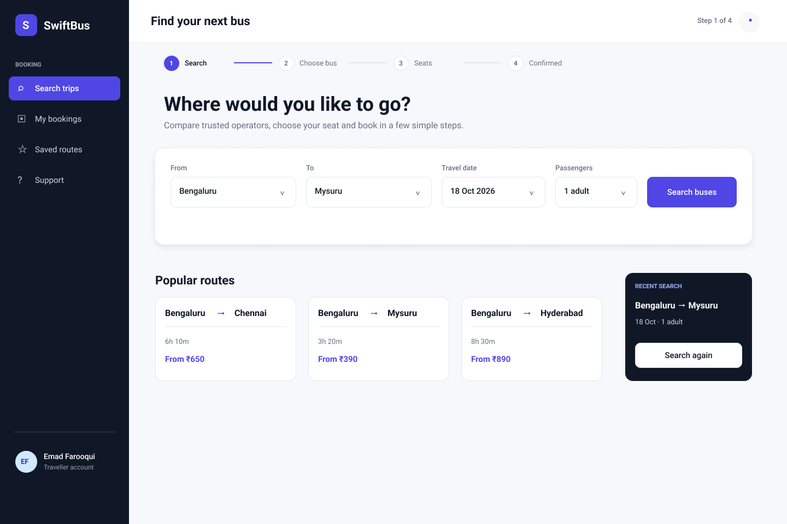

**Bus Selection — Figma**

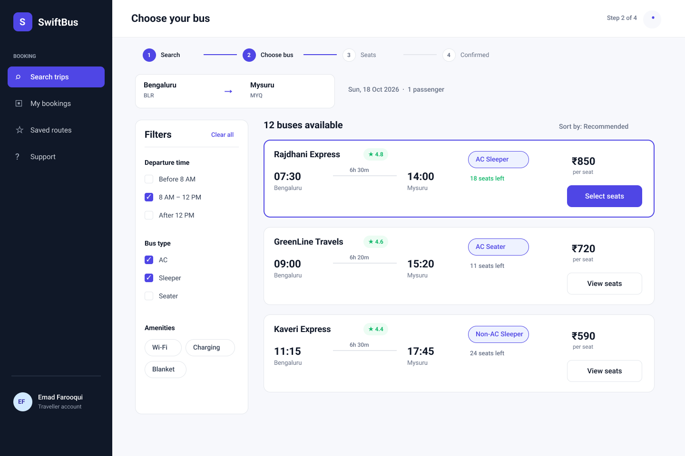

**Seat Selection — Figma**


**Booking Confirmation — Figma**

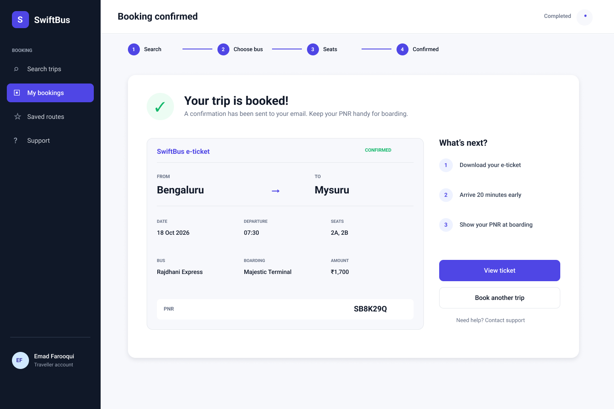

**Local Testing Website**

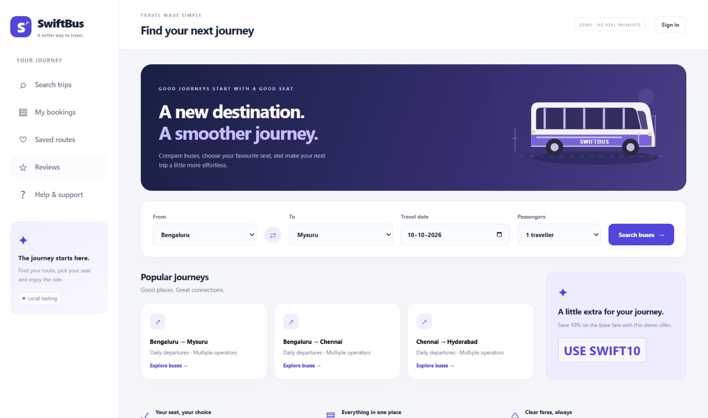

**Local account login**

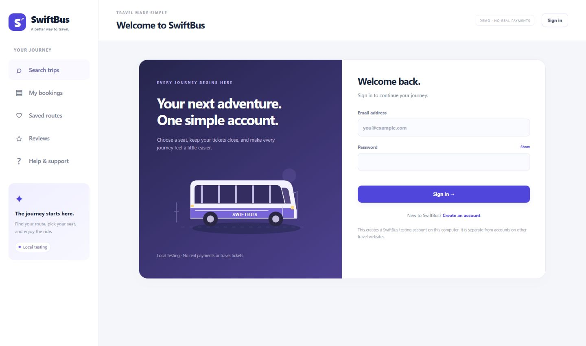

**Chosen seats and travel points**

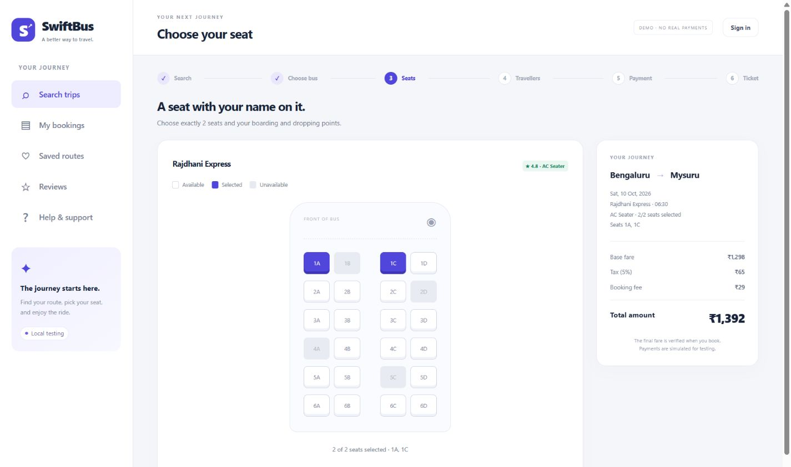

**Fare review and simulated payment**

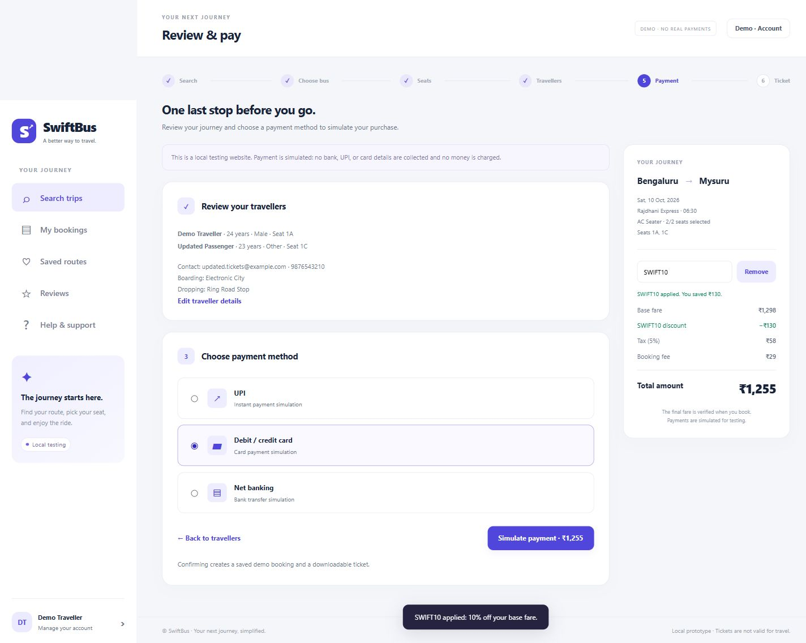

**Saved booking with updated details**

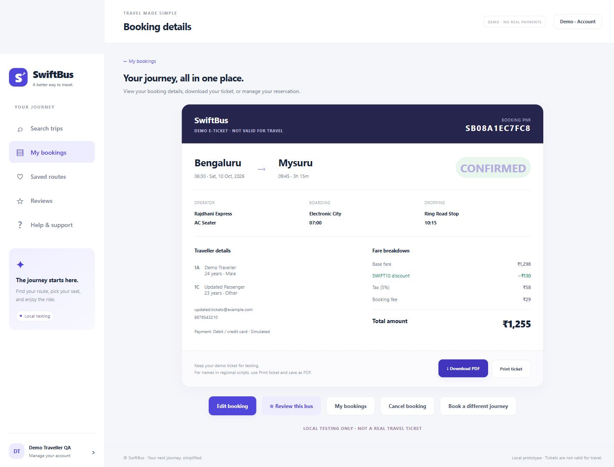

**Persistent booking history**

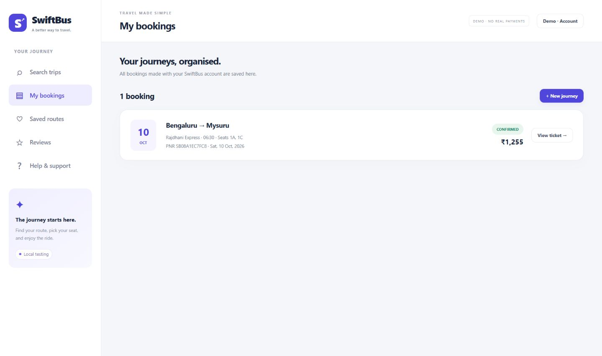

**Downloaded PDF ticket**

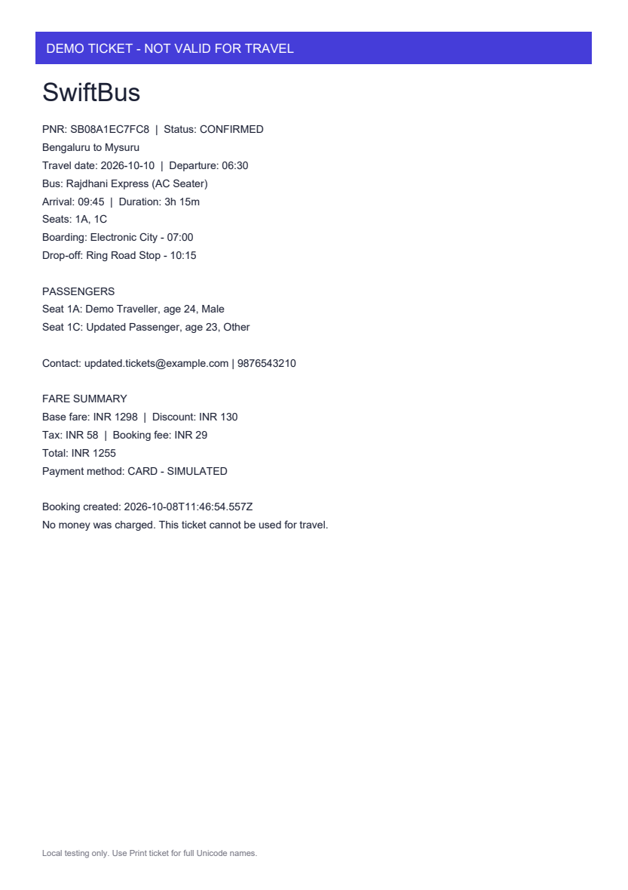

**Editable passengers, contact, and stops**

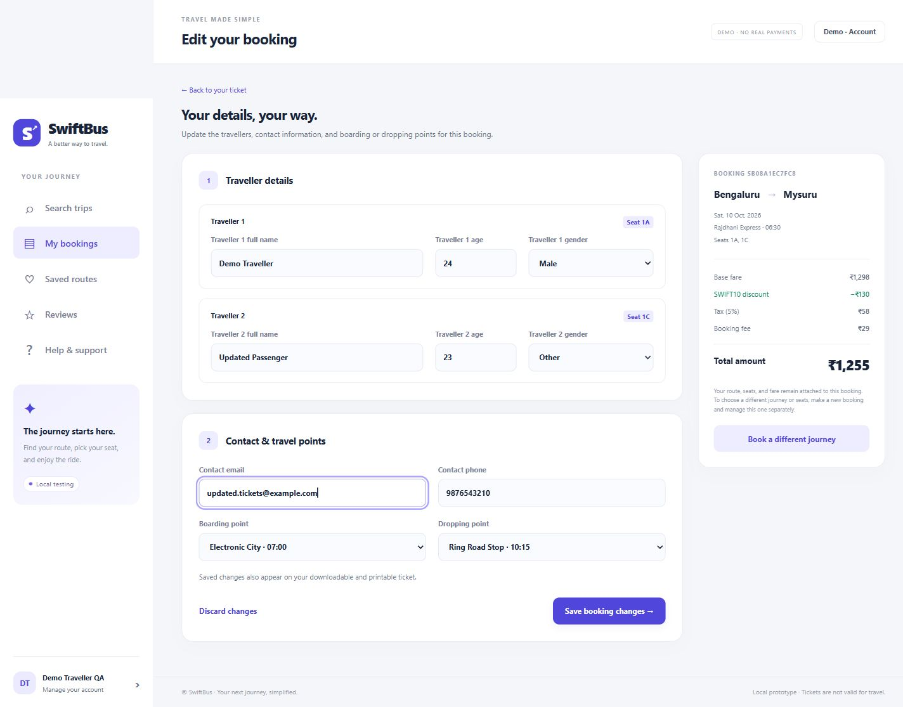

**Personal bus reviews and ratings**

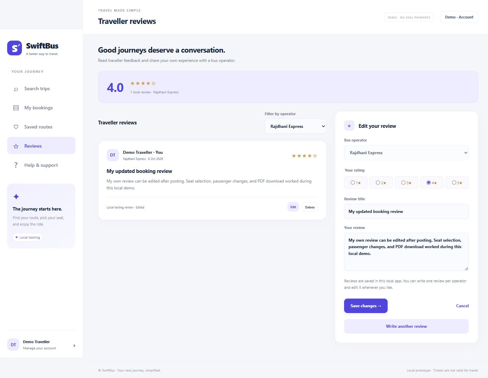

[Open the Figma prototype](https://www.figma.com/design/1Y71bhdPTjVX7d3ubsW6LV/Bus-Ticket-Booking-System---Prototype?node-id=11-177&p=f).

## Result

The desktop Figma prototype was extended into a working local SwiftBus website. Browser testing verified account registration and login, editable profile and email, custom trip and seat choices, passenger details, fare discounts, simulated checkout, saved bookings, ticket downloads, booking edits, review creation and editing, support requests, and cancellation with seat release. Eighteen backend integration scenarios passed, including account ownership, review deletion, persistence, validation, and concurrent booking checks. The website remains unpublished; payments, refunds, reservations, and reviews are for local testing.
