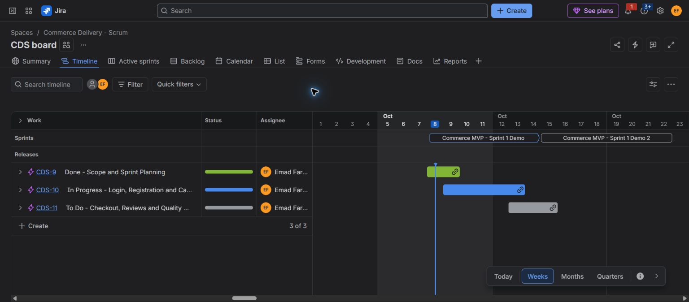
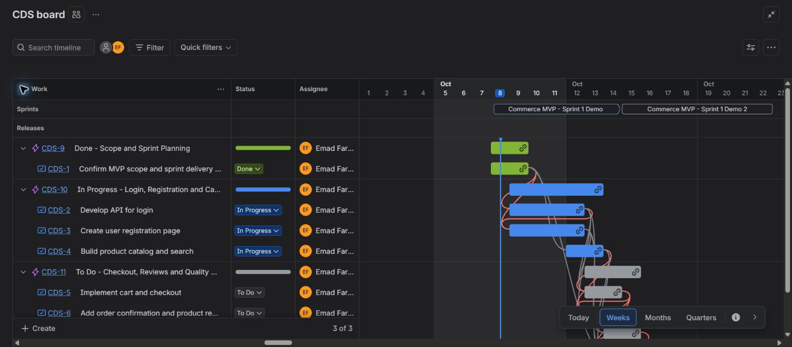
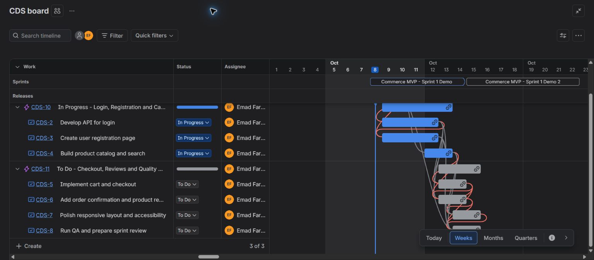
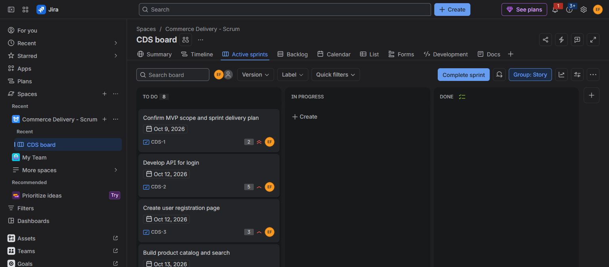
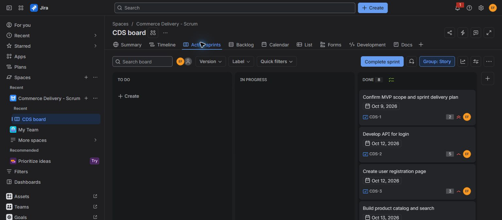

**Experiment 04: Jira Scrum**

## Aim

Create and manage a company-managed Jira Scrum project for a sample e-commerce application, including a prioritized backlog, a one-week sprint, detailed responsibilities, acceptance criteria, dependencies, and dated work in every status category.

Project: [**Commerce Delivery - Scrum (CDS)**](https://emadfar2020.atlassian.net/browse/CDS)  
Board: [**CDS board**, ID **2**](https://emadfar2020.atlassian.net/jira/software/c/projects/CDS/boards/2)  
Timeline: [**Sample project timeline**](https://emadfar2020.atlassian.net/jira/software/c/projects/CDS/boards/2/timeline)  
Active sprint: **Commerce MVP - Sprint 1 Demo**, ID **3**  
Planned sprint dates: **October 8-15, 2026**, Asia/Kolkata  
Assigned account: **Emad Farooqui**  
Sprint scope: **8 stories / 32 story points**

Planned product goal: Enable shoppers to register or sign in, discover products, manage a cart, complete simulated checkout, view order confirmation, and review purchases on phone and desktop.

The current board is a **simulated October 12 progress snapshot**, with work visible in **To Do**, **In Progress**, and **Done**. Setup took place on October 8. Dates describe the sample delivery plan; statuses do not certify implemented code, executed QA, or actual company activity.

## Tools Required

- Jira Cloud with a company-managed software Scrum project, backlog, active-sprint board, native Timeline, issue links, and sprint reports.
- An authenticated Chrome browser using the Emad Farooqui account.
- [backlog-plan.json](backlog-plan.json), containing the original detailed descriptions, priorities, estimates, roles, acceptance criteria, prerequisites, planned QA checks, and definitions of done.
- [sample-timeline-state.json](sample-timeline-state.json), recording the current sample sprint, statuses, dates, and parent epics.
- JPEG screenshots and saved UI records documenting both the original complete workflow simulation and the current mixed-status sample.

All eight stories and three grouping epics are assigned to Emad Farooqui. Role labels represent Product Owner, frontend, backend, full stack, and QA responsibilities. The workflow-demo label and description notes identify simulated delivery. Epics organize the Timeline; they are not additional sprint stories or added story points.

## Algorithm

1. Created **Commerce Delivery - Scrum** with key **CDS**, and created **CDS-1 through CDS-8** with full descriptions, native priorities, estimates, deadlines, role labels, simulation labels, and account assignment.
2. Prioritized the backlog around prerequisites and business impact. Checkout retained Highest priority while following authentication and catalog dependencies. Added and verified **21 native prerequisite links** using **is blocked by / blocks**.
3. Created and started **Commerce MVP - Sprint 1 Demo**, planned for October 8-15, with eight stories and 32 points. Captured **8 To Do / 0 In Progress / 0 Done**.
4. Demonstrated all eight stories moving through **To Do → In Progress → Done**. Captured the ending board with **0 To Do / 0 In Progress / 8 Done**, then closed the sprint early on October 8 for the original demonstration.
5. Reopened the same sprint, ID **3**, retaining its native name **Commerce MVP - Sprint 1 Demo** and October 8-15 window. Set its stories to a simulated October 12 progress snapshot.
6. Set native Start date and Due date fields on every story. Created three dated parent epics, each with a description, work checklist, owner, and sample disclaimer, to show scheduled work in every Timeline category.
7. Assigned the stories to their corresponding epics. Verified the active board shows **4 To Do / 3 In Progress / 1 Done**, with **32 points**, and verified the dated epic/story groups on the Timeline.
8. Saved current board and Timeline screenshots. Preserved the original sprint start, end, and closed-report screenshots as historical evidence.

Current scheduled stories and responsibilities:

| Issue | Work to show | Category | Start | Due at 17:00 IST | Role | Points | Priority | Native prerequisites |
| --- | --- | --- | --- | --- | --- | ---: | --- | --- |
| [CDS-1](https://emadfar2020.atlassian.net/browse/CDS-1) | Agree scope, acceptance examples, responsibilities, and sprint plan | Done | October 8 | October 9 | Product Owner | 2 | Highest | None |
| [CDS-2](https://emadfar2020.atlassian.net/browse/CDS-2) | Develop login/session API and review authentication integration | In Progress | October 9 | October 12 | Backend Engineer | 5 | High | CDS-1 |
| [CDS-3](https://emadfar2020.atlassian.net/browse/CDS-3) | Build registration/sign-in forms and integrate the agreed API | In Progress | October 9 | October 12 | Frontend Engineer | 3 | High | CDS-1, CDS-2 |
| [CDS-4](https://emadfar2020.atlassian.net/browse/CDS-4) | Prepare product data and implement catalog, search, and filters | In Progress | October 12 | October 13 | Frontend Engineer | 5 | High | CDS-1 |
| [CDS-5](https://emadfar2020.atlassian.net/browse/CDS-5) | Implement cart totals, checkout validation, and simulated payment | To Do | October 13 | October 14 | Full Stack Engineer | 8 | Highest | CDS-2, CDS-3, CDS-4 |
| [CDS-6](https://emadfar2020.atlassian.net/browse/CDS-6) | Show order confirmation and allow eligible product reviews | To Do | October 13 | October 14 | Full Stack Engineer | 3 | Medium | CDS-2, CDS-4, CDS-5 |
| [CDS-7](https://emadfar2020.atlassian.net/browse/CDS-7) | Improve responsive layouts, keyboard controls, and accessibility | To Do | October 14 | October 15 | Frontend Engineer | 2 | Medium | CDS-3, CDS-4, CDS-5, CDS-6 |
| [CDS-8](https://emadfar2020.atlassian.net/browse/CDS-8) | Run final QA, record defects/retests, and prepare sprint review | To Do | October 14 | October 15 | QA Engineer | 4 | High | CDS-1 through CDS-7 |
| **Total** | **8 scheduled stories** | **4 To Do / 3 In Progress / 1 Done** | | | | **32** | | **21 links** |

All dates in the table are in **2026**. Preparation can overlap: registration forms can be built against the API contract while authentication is underway, and confirmation/review components can be prepared before checkout is complete. Final integration and acceptance still depend on the linked prerequisites. In Progress indicates work underway, not that all dependencies are complete.

Native Timeline categories:

| Parent epic | Status | Schedule | Child stories | What the category demonstrates |
| --- | --- | --- | --- | --- |
| [CDS-9: Done - Scope and Sprint Planning](https://emadfar2020.atlassian.net/browse/CDS-9) | Done | October 8-9 | CDS-1 | Completed sample planning: scope, acceptance examples, responsibilities, and sprint plan |
| [CDS-10: In Progress - Login, Registration and Catalog](https://emadfar2020.atlassian.net/browse/CDS-10) | In Progress | October 9-13 | CDS-2, CDS-3, CDS-4 | Current sample engineering: authentication, account forms, catalog, search, and integration |
| [CDS-11: To Do - Checkout, Reviews and Quality Assurance](https://emadfar2020.atlassian.net/browse/CDS-11) | To Do | October 13-15 | CDS-5, CDS-6, CDS-7, CDS-8 | Upcoming sample work: purchasing, confirmation, reviews, usability, final QA, and stakeholder review |

Each category epic explains its planned work through a description and checklist, includes native dates and assignment, and identifies the October 12 state as simulated.

Product Owner responsibilities are scope, acceptance criteria, prioritization, and product acceptance. Engineering responsibilities are interface agreement, implementation, review, and defect resolution. QA responsibilities are test preparation, evidence, regression, and defect tracking. The Scrum facilitator handles daily check-ins, impediments, review, and retrospective. Emad Farooqui represents these roles through labels and descriptions.

Planned company meeting cadence, in IST:

| Meeting | Planned schedule | Purpose and accountable role |
| --- | --- | --- |
| Sprint planning | October 8, 45 minutes | Product Owner and delivery roles agree goal, scope, estimates, responsibilities, and dependencies. |
| Daily Scrum | October 9 and 12-15, 09:30, 15 minutes | Delivery roles inspect progress and agree the next day's work; facilitator supports impediment resolution. |
| Backlog refinement | October 12, 30 minutes | Product Owner, engineering, and QA clarify upcoming work and acceptance examples. |
| Sprint review | October 15, 17:00, 30 minutes | Product Owner and QA inspect product evidence against the sprint goal with stakeholders. |
| Retrospective | October 15, 17:30, 20 minutes | Delivery roles and facilitator agree process improvements with owners. |

These meetings are planned, not recorded as held. Escalating a blocker records an owner, impact, and next action in the issue. Actual acceptance requires reviewed changes, recorded checks, resolved blocking defects, and Product Owner acceptance.

## Output Screenshots

**Current active sample board — four To Do, three In Progress, one Done**

**Current native Timeline — scheduled work in all three categories**

**Expanded Timeline — planning and engineering work**

**Expanded Timeline — upcoming purchasing and quality work**

**Historical sprint start — eight stories in To Do**

**Historical sprint end — eight stories in Done before the original closure**

Additional historical JPEG evidence:

| Screenshot | Evidence |
| --- | --- |
| [01b-prioritized-sprint-backlog.jpg](screenshots/01b-prioritized-sprint-backlog.jpg) | Original ranked stories with priorities, estimates, and deadlines. |
| [02a-sprint-dates.jpg](screenshots/02a-sprint-dates.jpg) | Original October 8-15 sprint dates and goal. |
| [06-sprint-in-progress.jpg](screenshots/06-sprint-in-progress.jpg) | Original complete workflow simulation with all eight stories In Progress. |
| [04-sprint-report.jpg](screenshots/04-sprint-report.jpg) | Historical closed report captured before the sprint was reopened. |
| [04a-completed-issues.jpg](screenshots/04a-completed-issues.jpg) | Historical completed-issues list showing all eight stories Done. |
| [05-item-details.jpg](screenshots/05-item-details.jpg) | Original assignment, role label, priority, estimate, deadline, and planning criteria. |
| [05a-company-cadence.jpg](screenshots/05a-company-cadence.jpg) | Original saved company cadence and simulation note. |

The original [evidence.json](evidence.json), [starting board](sprint-start-board.txt), [In Progress board](sprint-in-progress-board.txt), [ending board](sprint-end-board.txt), [closed report](sprint-report.txt), and [planning story](planning-story.txt) preserve the earlier state. They are historical records, not the current active state. The original [backlog-plan.json](backlog-plan.json) retains its original simulation-outcome text; use [sample-timeline-state.json](sample-timeline-state.json) for the updated mapping.

Native-dependency records: [checkout](checkout-dependencies.txt), [confirmation/reviews](order-dependencies.txt), [responsive/accessibility](accessibility-dependencies.txt), and [QA](qa-dependencies.txt).

## Result

**Updated and verified.** **Commerce Delivery - Scrum (CDS)** now presents an active, dated sample sprint with **eight prioritized stories**, **32 points**, **21 native prerequisite links**, and assignment to **Emad Farooqui**. Its simulated **October 12 snapshot** shows **4 To Do / 3 In Progress / 1 Done**. Three dated parent epics organize the native Timeline into **Done**, **In Progress**, and **To Do**, with descriptions and checklists explaining each group's work.

The sprint is **active after reopening**, retains its native name **Commerce MVP - Sprint 1 Demo**, and is planned for **October 8-15, 2026**. The original complete **To Do → In Progress → Done** demonstration and start/end screenshots are preserved. The old closed-report screenshot records the earlier October 8 closure and does not describe the current state. Existing sprint-goal wording also retains historical closure information; the current sample state is identified in the category descriptions and this updated documentation.

Historical report caveat: the earlier closed report marked issues with an asterisk because its configured 18:00 start preceded bulk assignment at approximately 18:03 and the actual Start action at approximately 18:05. All eight stories were present before Start was pressed. This timestamp detail belongs to the earlier demonstration.

This experiment demonstrates Jira planning, dates, ownership, dependencies, workflow transitions, and visible Timeline categories. Application implementation, executed QA, real payment integration, deployment, and actual future delivery remain unverified.

