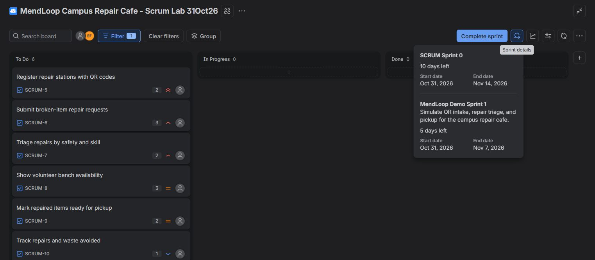
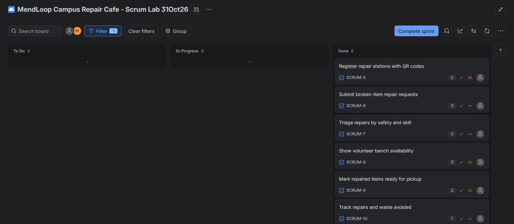

# Experiment 04: Jira Scrum — MendLoop Campus Repair Cafe

## Aim

Create a Scrum project in Jira, prioritize a backlog of at least five items, plan and start a one-week sprint, and capture its starting and simulated ending boards.

## Project

MendLoop is a campus repair cafe concept: students submit broken items, volunteers triage and repair them, and repaired items return to their owners.

- **Project:** MendLoop Campus Repair Cafe - Scrum Lab 31Oct26
- **Project key:** SCRUM
- **Jira board:** [MendLoop board, ID 1](https://praveen-1793422582117.atlassian.net/jira/software/projects/SCRUM/boards/1)
- **Sprint:** MendLoop Demo Sprint 1, ID 3
- **Planned duration:** 31 October–7 November 2026 (one week)
- **Sprint goal:** Simulate QR intake, repair triage, and pickup for the campus repair cafe.

## Prioritized Backlog

The six experiment items were ranked in this order and moved into the sprint. Each item includes acceptance criteria and a simulation note in Jira.

| Rank | Jira item | Backlog item | Priority | Story points |
| --- | --- | --- | --- | ---: |
| 1 | [SCRUM-5](https://praveen-1793422582117.atlassian.net/browse/SCRUM-5) | Register repair stations with QR codes | Highest | 2 |
| 2 | [SCRUM-6](https://praveen-1793422582117.atlassian.net/browse/SCRUM-6) | Submit broken-item repair requests | High | 3 |
| 3 | [SCRUM-7](https://praveen-1793422582117.atlassian.net/browse/SCRUM-7) | Triage repairs by safety and skill | High | 2 |
| 4 | [SCRUM-8](https://praveen-1793422582117.atlassian.net/browse/SCRUM-8) | Show volunteer bench availability | Medium | 3 |
| 5 | [SCRUM-9](https://praveen-1793422582117.atlassian.net/browse/SCRUM-9) | Mark repaired items ready for pickup | Medium | 2 |
| 6 | [SCRUM-10](https://praveen-1793422582117.atlassian.net/browse/SCRUM-10) | Track repairs and waste avoided | Low | 1 |
| **Total** | **6 items** | | | **13** |

## Procedure

1. Created the uniquely named MendLoop project using Jira's Scrum template.
2. Added the six backlog items with priorities, estimates, acceptance criteria, and simulation notes.
3. Created and started **MendLoop Demo Sprint 1** with a one-week planned schedule.
4. Captured the starting board with all six items in **To Do**.
5. Demonstrated the workflow by moving the six items through **In Progress** to **Done**.
6. Captured the simulated ending board, then completed the demo sprint early on **31 October 2026**.

The baseline sample tasks and **SCRUM Sprint 0** were kept separate and unchanged.

| Demonstration stage | To Do | In Progress | Done |
| --- | ---: | ---: | ---: |
| Sprint start | 6 | 0 | 0 |
| Work in progress | 0 | 6 | 0 |
| Simulated sprint end | 0 | 0 | 6 |

## Screenshots

**Sprint start — six items in To Do**

**Simulated sprint end — six items in Done**

Both screenshots are genuine Jira captures from **31 October 2026**. The starting capture also shows details for the separate sample sprint; the board is filtered to the six MendLoop experiment items.

## Result

Created and prioritized a six-item backlog totaling **13 story points**, planned and started a **one-week sprint**, demonstrated **To Do → In Progress → Done**, and captured both board states.

This is a Jira workflow simulation. The sprint was closed early on the same day; no week elapsed, and the status changes do not demonstrate implemented or tested application software.
