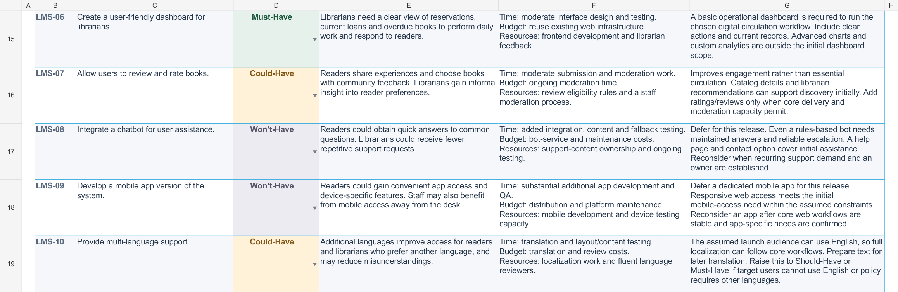
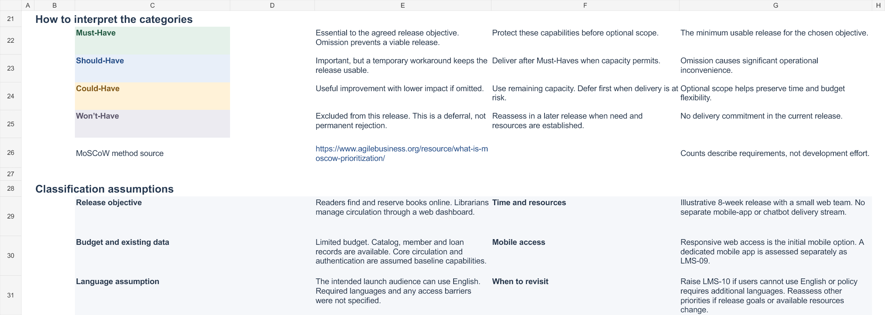

# Experiment 05: Library Management System MoSCoW Prioritization

## Aim

Categorize the ten Library Management System requirements using the MoSCoW method, considering their impact on users and stakeholders and their feasibility within time, budget, and resource constraints. Present each category and its justification in an organized spreadsheet.

## Tools Required

- [Completed Excel workbook](Library_Management_System_MoSCoW.xlsx), with the worksheet **MoSCoW Priorities**.
- Microsoft Excel to open and edit the workbook. The `.xlsx` file can also be imported into Google Sheets.
- The ten requirements from the experiment brief and the MoSCoW prioritization method.

The repository contains the Excel deliverable. Download the workbook using GitHub's **Download raw file** control to open it in Excel, or upload it to Google Sheets.

## Algorithm

1. Record each supplied requirement once, assigning IDs **LMS-01 through LMS-10**.
2. State the planning assumptions: an **eight-week first web release**, a small web team, limited budget, and existing catalog, member, and loan data. These are sample assumptions because the brief does not provide numerical constraints.
3. Evaluate the effect of each feature on readers, librarians, and administrators. Record implementation effort, likely costs, and required people or services separately.
4. Assign **Must-Have** to essential first-release functions, **Should-Have** to important functions with temporary alternatives, **Could-Have** to useful enhancements, and **Won't-Have** to functions deferred from this release.
5. Explain each decision in the workbook's **Why this priority?** column, including fallback options and conditions that could change the priority.
6. Organize the worksheet with a filtered requirements table, category dropdowns, category colors, frozen headers and identifying columns, and formula-based summary counts.
7. Verify that all ten requirements are retained, their explanations are complete, and the category totals equal ten. Inspect the saved workbook for Excel error cells and review the rendered worksheet views.

| ID | Requirement | Category |
| --- | --- | --- |
| LMS-01 | Search books by title and author | Must-Have |
| LMS-02 | Online book reservation system | Must-Have |
| LMS-03 | Monthly reports on borrowed books for administrators | Should-Have |
| LMS-04 | Email notifications for overdue books | Should-Have |
| LMS-05 | QR code scanning for borrowing and returning books | Could-Have |
| LMS-06 | User-friendly dashboard for librarians | Must-Have |
| LMS-07 | User reviews and ratings for books | Could-Have |
| LMS-08 | Chatbot for user assistance | Won't-Have |
| LMS-09 | Dedicated mobile app version | Won't-Have |
| LMS-10 | Multi-language support | Could-Have |

The workbook includes the full impact, feasibility, and justification for every row. **Won't-Have** means deferred from the assumed first release. Responsive web access remains the initial mobile-access approach. Language support should be reprioritized if the intended users cannot use English or another language is required by policy.

## Output Screenshots

Rendered views of the completed worksheet:

**Category summary and requirements LMS-01 through LMS-05**

**Requirements LMS-06 through LMS-10**

**MoSCoW guide and delivery considerations**

## Result

All **ten requirements** are categorized and justified in the completed Excel workbook: **3 Must-Have, 2 Should-Have, 3 Could-Have, and 2 Won't-Have**. Each requirement includes its impact on users and stakeholders, feasibility across time, budget and resources, and the reason for its priority.

The saved workbook retains all ten unique requirements, valid categories, complete explanations, and matching cached summary totals. No Excel error cells were found. The prioritization reflects the stated sample release assumptions and can be revised using the category dropdowns as stakeholder needs or constraints change.
