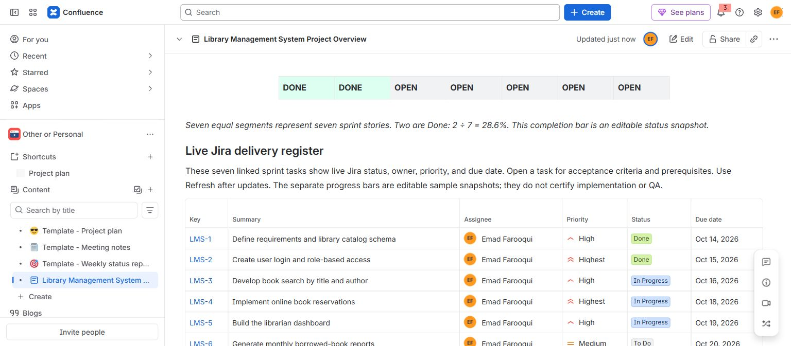
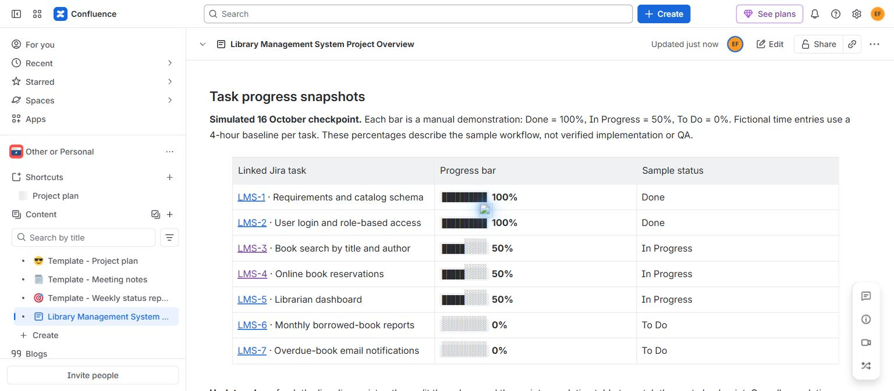
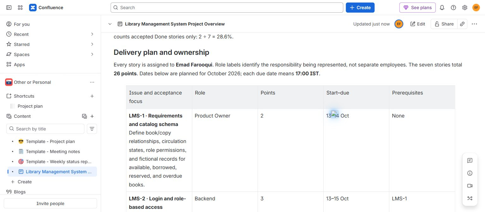
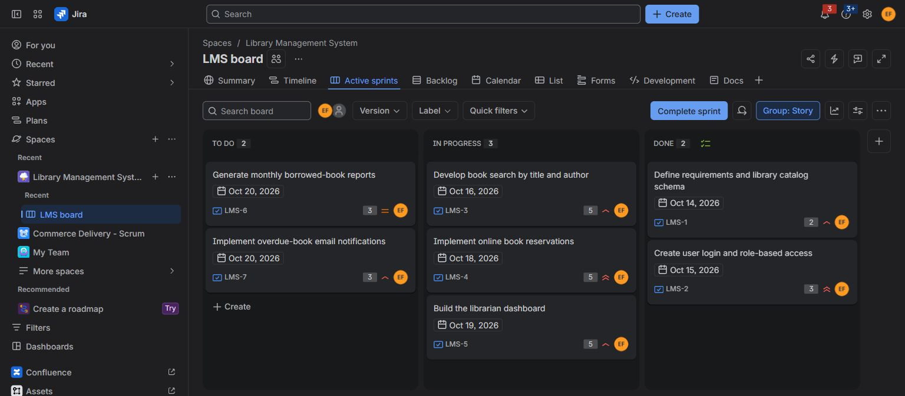

# Experiment 6: Jira and Confluence Integration for a Library Management System

## Aim

To link Library Management System development tasks in Jira with a Confluence page titled **Library Management System Project Overview**, enabling stakeholders to monitor task status, ownership, priorities, deadlines, dependencies, and sprint progress in one place.

## Tools Required

- **Jira Cloud:** company-managed **Library Management System (LMS)** Scrum project and **LMS Sprint 1**.
- **Confluence Cloud:** project overview page in the existing **OOP** space, with the Jira Work Items macro, Table of Contents, schedule tables, progress displays, and review guidance.
- **Chrome:** access Jira and Confluence and capture output screenshots.

## Algorithm

1. Create the **LMS** Jira Scrum project and prepare the one-week **LMS Sprint 1**, planned for **13–20 October 2026**.
2. Create seven development stories, **LMS-1 through LMS-7**, covering requirements, login, book search, reservations, the librarian dashboard, monthly reports, and overdue notifications.
3. Add a description, scope, four acceptance criteria, priority, story-point estimate, planned start date, due date, and responsible role to every story. Assign all stories to **Emad Farooqui** and use role labels to identify the responsibility represented by each task.
4. Add **13 prerequisite links** between the stories. Add all seven stories to the sprint, giving a total estimate of **26 story points**, and start the sprint.
5. Simulate a **16 October checkpoint** with **2 Done, 3 In Progress, and 2 To Do** stories. This is a sample workflow, not evidence of completed software development or employee activity.
6. Create the Confluence page **Library Management System Project Overview**. Add the project purpose, owner, sprint dates, planned scope, and a note identifying the simulated checkpoint.
7. Insert the **Jira Work Items macro** using the following JQL:

   ```jql
   project = LMS AND sprint = 5 ORDER BY key ASC
   ```

   Display **Key, Summary, Assignee, Priority, Status, and Due Date**. Link each issue key to its Jira record so stakeholders can open its acceptance criteria and dependencies. Refresh the macro after Jira updates.
8. Calculate sprint completion as **2 Done stories ÷ 7 stories × 100 = 28.6%**. Display an overall progress bar with two of seven equal segments coloured and the percentage beside it.
9. Add individual progress bars for LMS-1 through LMS-7: **100%, 100%, 50%, 50%, 50%, 0%, and 0%**. Clearly label these bars as **manual sample snapshots**; they must be edited when progress changes.
10. Add the delivery schedule, ownership, dependencies, risks, next actions, Definition of Done, and review workflow. Insert a Table of Contents, save the page, and mark it **Ready for review**.
11. Verify the saved page and active sprint board, then capture screenshots showing the linked Jira issues, overall completion, task progress, delivery plan, and sprint statuses.

**Task schedule and responsibilities**

All stories are assigned to **Emad Farooqui**. Roles represent sample responsibilities rather than separate employees. Dates below are in **October 2026**, with planned deadlines at **17:00 IST**.

| Jira issue | Development task | Sample status | Priority | Points | Responsible role | Planned start–due | Prerequisites |
| --- | --- | --- | --- | ---: | --- | --- | --- |
| LMS-1 | Define requirements and library catalog schema | Done | High | 2 | Product Owner | 13–14 Oct | None |
| LMS-2 | Create user login and role-based access | Done | Highest | 3 | Backend Engineer | 13–15 Oct | LMS-1 |
| LMS-3 | Develop book search by title and author | In Progress | High | 5 | Frontend Engineer | 14–16 Oct | LMS-1 |
| LMS-4 | Implement online book reservations | In Progress | Highest | 5 | Full Stack Engineer | 15–18 Oct | LMS-1, LMS-2, LMS-3 |
| LMS-5 | Build the librarian dashboard | In Progress | High | 5 | Frontend Engineer | 15–19 Oct | LMS-1, LMS-2, LMS-4 |
| LMS-6 | Generate monthly borrowed-book reports | To Do | Medium | 3 | Backend Engineer | 19–20 Oct | LMS-1, LMS-2, LMS-5 |
| LMS-7 | Implement overdue-book email notifications | To Do | High | 3 | Backend Engineer | 19–20 Oct | LMS-1, LMS-2 |

**Acceptance and review workflow**

Acceptance criteria cover consistent catalog and circulation rules, role access and logout, title/author searches and empty results, duplicate-reservation prevention, dashboard totals, accurate monthly reports and CSV output, and overdue-reminder previews with duplicate and failure handling. Each Jira story retains its detailed scope and acceptance criteria.

For actual delivery, the Definition of Done requires reviewed implementation, acceptance evidence, verified permissions and dependent data flows, and updated documentation. Stakeholders can use Confluence comments for project feedback and Jira comments for task-specific decisions. Approval is recorded only when it occurs.

After Jira changes, refresh the issue macro, recalculate the Done percentage, edit the manual progress bars and checkpoint date, and update risks and next actions. The overall completion percentage counts **Done stories**; individual bars illustrate the sample workflow.

## Output Screenshots

**Confluence overview: linked Jira issues and 28.6% sprint completion**



**Individual task progress: seven manual sample progress bars**



**Delivery plan excerpt: responsibilities, estimates, dates, and dependencies**



The saved page contains the full seven-story delivery plan, risks, Definition of Done, and review workflow.

**Jira sprint board: 2 Done, 3 In Progress, and 2 To Do**



## Result

Created [Library Management System Project Overview](https://emadfar2020.atlassian.net/wiki/spaces/OOP/pages/1114113/Library+Management+System+Project+Overview) in Confluence with seven linked Jira stories, live status information, ownership, priorities, deadlines, dependencies, acceptance and review guidance, an overall completion bar, and individual task-progress bars. The page is **Ready for review**.

The [active Jira sprint board](https://emadfar2020.atlassian.net/jira/software/c/projects/LMS/boards/3) contains **LMS Sprint 1**, planned for **13–20 October 2026**, with **26 story points**. Its simulated checkpoint shows **2 Done / 3 In Progress / 2 To Do**, giving **28.6% completion**. Jira issue statuses are live; the progress bars are manual sample snapshots. Four screenshots document the completed tracking demonstration.
