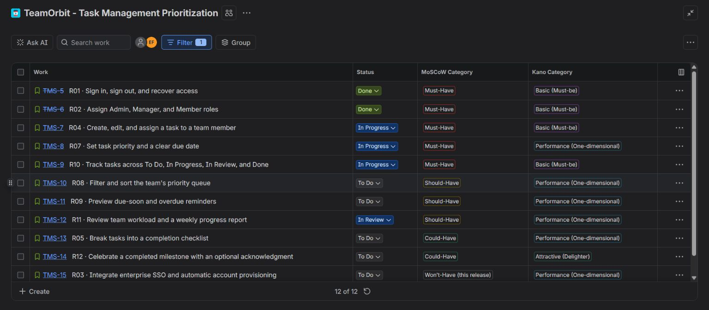
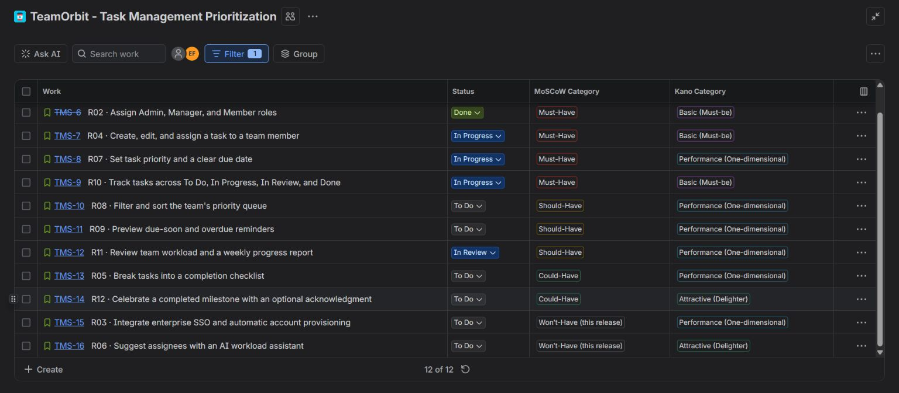
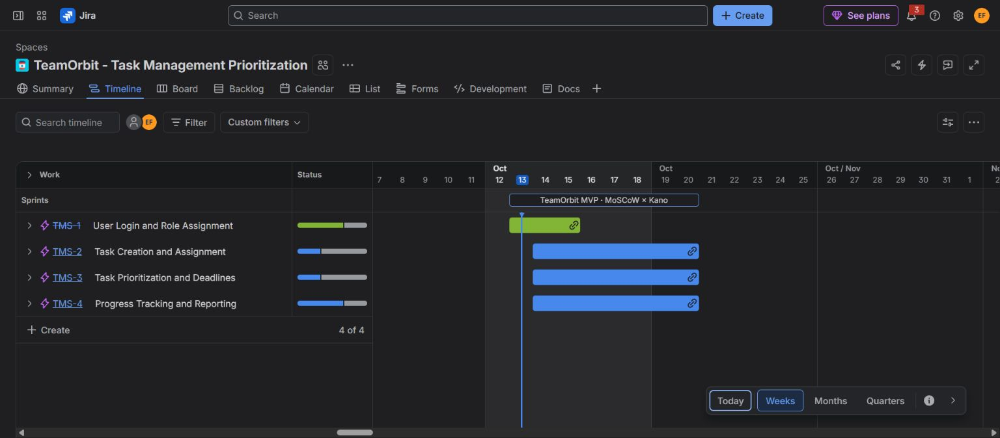
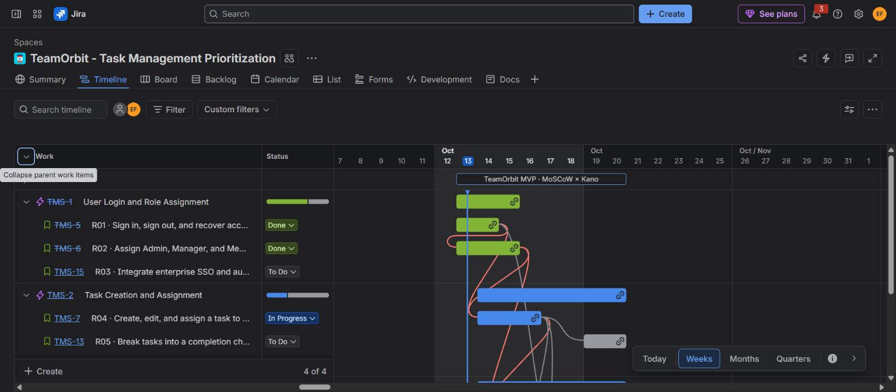
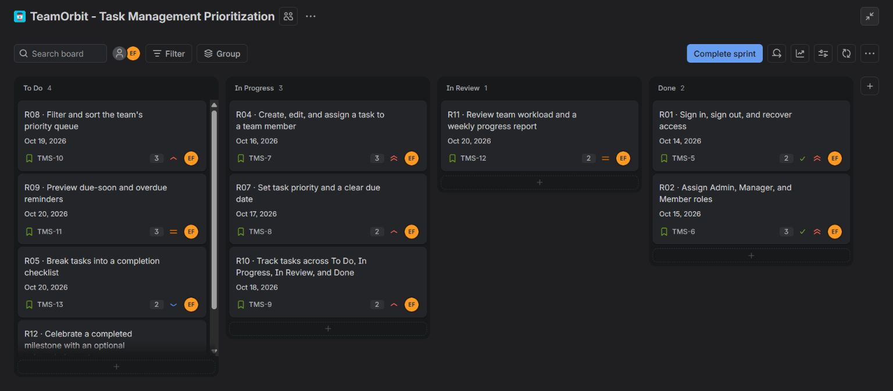
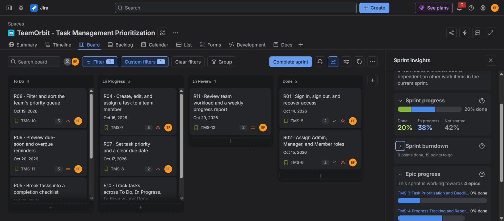
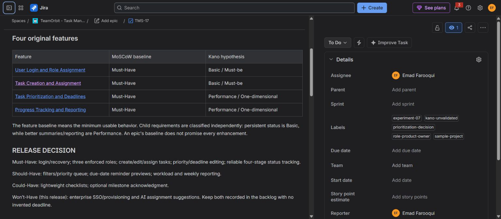
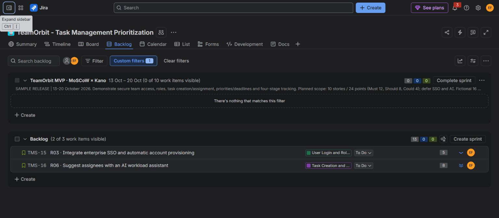
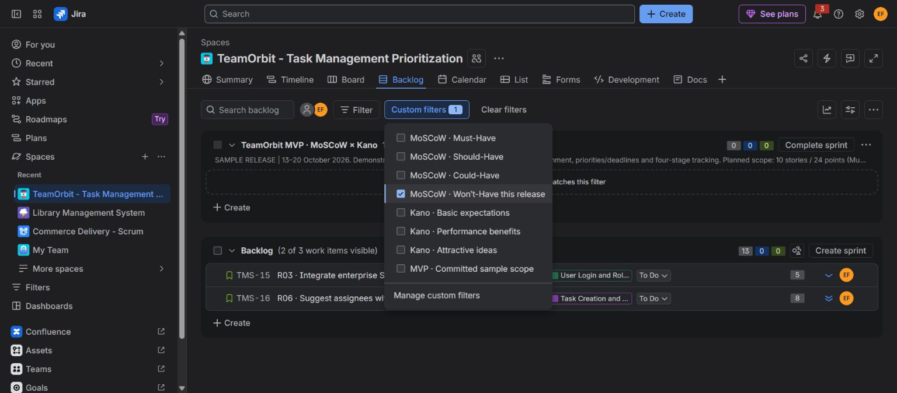

# Experiment 7: Task Management System Prioritization in Jira

## Aim

To prioritize a small team's Task Management System using **MoSCoW** for release scope and **Kano** for expected user satisfaction, covering **User Login and Role Assignment, Task Creation and Assignment, Task Prioritization and Deadlines, and Progress Tracking and Reporting**.

The separate **TeamOrbit - Task Management Prioritization** private team-managed Jira project is **TMS**, board **4**. Its active sprint **6**, **TeamOrbit MVP · MoSCoW × Kano**, runs from **13–20 October 2026**. Twelve native stories, both model values, descriptions, priorities, assignments, estimates, dates, labels, sample statuses, and **26 prerequisite links** have been checked against the requirement plan. The project also contains the four original feature epics, eight tested native model/scope filters, and [the prioritization decision record, TMS-17](https://emadfar2020.atlassian.net/browse/TMS-17). Nine output screenshots have been visually reviewed. Sample statuses represent a fictional **16 October checkpoint**; they do not establish implemented software, QA, actual work, or stakeholder approval.

## Tools Required

- **Jira Cloud:** private **TMS** Scrum project, four feature epics, twelve stories, native Priority, assignee, role labels, story-point estimates, dates, 26 prerequisite links, backlog, four-column board, and native Sprint insights.
- **Native project-scoped dropdowns:** **MoSCoW Category** with Must-Have, Should-Have, Could-Have, and Won’t-Have (this release); **Kano Category** with Basic (Must-be), Performance (One-dimensional), Attractive (Delighter), Indifferent, and Reverse. All twelve stories' intended model values have been verified.
- **Saved requirement filter, TeamOrbit Requirements:** Story-only scope with twelve results; the saved default List layout displays **Work, Status, MoSCoW Category, and Kano Category** side by side and persists when the List page is reopened.
- **Eight native custom filters:** four MoSCoW categories, three Kano hypotheses, and the committed sample sprint scope, using the actual dropdown fields and tested result sets.
- **Chrome:** inspect saved Jira records and capture real output screenshots.
- Primary model references: [Agile Business Consortium](https://www.agilebusiness.org/resource/what-is-moscow-prioritization/) and [Kano et al. (1984)](https://www.jstage.jst.go.jp/article/quality/14/2/14_KJ00002952366/_article).

All actual story assignments use **Emad Farooqui**. The private project's configured access contains one user, Emad, as Admin. Role labels show the responsibility represented in the sample and do not create separate employees. Admin, Manager, and Member are product roles described in the system requirements, not three additional Jira accounts.

## Algorithm

1. Define the release context: one small team, three product roles, a bounded first release, and a one-week sample timebox. Treat story points as relative estimates rather than proven capacity.
2. Create a separate Jira project and four feature epics with the original requirement titles: **User Login and Role Assignment**, **Task Creation and Assignment**, **Task Prioritization and Deadlines**, and **Progress Tracking and Reporting**.
3. Decompose the four requested features into **12 stories**, separating viable baseline behavior from improvements and future discovery. Enter purpose, scope, user impact, feasibility, acceptance criteria, owner, role label, estimate, schedule, and prerequisites for every story.
4. Assign MoSCoW scope independently of Jira urgency. **Must Have** is needed for the usable baseline; **Should Have** allows a temporary workaround; **Could Have** is optional contingency; **Won't Have this release** is recorded outside this release. These categories follow the [Agile Business Consortium's scope rules](https://www.agilebusiness.org/resource/what-is-moscow-prioritization/).
5. Record a **Kano hypothesis** separately. **Basic / Must-be** behavior is expected, **Performance / One-dimensional** quality progressively affects satisfaction, and **Attractive** behavior may delight. The project-specific categories are assumptions, informed by the [original Kano research](https://www.jstage.jst.go.jp/article/quality/14/2/14_KJ00002952366/_article), and have **not** been validated by a customer survey.
6. Use the following model register. A Must requirement can be a Performance hypothesis, and a deferred requirement can be Attractive; the models answer different questions.

   The four original feature groups are classified by their minimum usable baseline. All four need a baseline in a usable Task Management System; this does not make every enhancement mandatory. Optional and deferred child stories retain their own classifications rather than inheriting an epic-wide promise. Within Progress Tracking and Reporting, persistent status is a Basic hypothesis, while clearer reporting is a Performance hypothesis.

   All twelve saved stories and their model/status values were verified. The workflow is a sample configuration, and the dates are planned deadlines rather than claims of delivered software. The table uses requirement-ID order for lookup; Jira Rank prioritizes **Must → Should → Could → Won’t**, so deferred requirements appear after the release scope.

| Original feature group | Baseline MoSCoW | Baseline Kano hypothesis | Minimum release behavior | Enhanced scope |
|---|---|---|---|---|
| User Login and Role Assignment | Must Have | Basic / Must-be | Secure access and three enforced team roles | Enterprise SSO deferred |
| Task Creation and Assignment | Must Have | Basic / Must-be | Create, edit, and assign tasks with accountable ownership | Checklist Could; AI suggestions deferred |
| Task Prioritization and Deadlines | Must Have | Performance / One-dimensional | Visible priority, due date, and overdue state | Filters and reminders Should |
| Progress Tracking and Reporting | Must Have | Performance / One-dimensional | Reliable shared task status and count-based progress | Workload/reporting Should; celebration Could |

| Plan ID / Jira key | Requirement | MoSCoW scope | Kano hypothesis | Jira priority | Points | Sample status | Planned due |
|---|---|---|---|---|---:|---|---|
| R01 / TMS-5 | Sign in, sign out, and recover access | Must Have | Basic / Must-be | Highest | 2 | Done | 2026-10-14 |
| R02 / TMS-6 | Assign Admin, Manager, and Member roles | Must Have | Basic / Must-be | Highest | 3 | Done | 2026-10-15 |
| R03 / TMS-15 | Integrate enterprise SSO and automatic account provisioning | Won't Have this release | Performance / One-dimensional | Low | 5 | To Do | Deferred; not scheduled |
| R04 / TMS-7 | Create, edit, and assign a task to a team member | Must Have | Basic / Must-be | Highest | 3 | In Progress | 2026-10-16 |
| R05 / TMS-13 | Break tasks into a completion checklist | Could Have | Performance / One-dimensional | Low | 2 | To Do | 2026-10-20 |
| R06 / TMS-16 | Suggest assignees with an AI workload assistant | Won't Have this release | Attractive | Lowest | 8 | To Do | Deferred; not scheduled |
| R07 / TMS-8 | Set task priority and a clear due date | Must Have | Performance / One-dimensional | High | 2 | In Progress | 2026-10-17 |
| R08 / TMS-10 | Filter and sort the team's priority queue | Should Have | Performance / One-dimensional | High | 3 | To Do | 2026-10-19 |
| R09 / TMS-11 | Preview due-soon and overdue reminders | Should Have | Performance / One-dimensional | Medium | 3 | To Do | 2026-10-20 |
| R10 / TMS-9 | Track tasks across To Do, In Progress, In Review, and Done | Must Have | Basic / Must-be | High | 2 | In Progress | 2026-10-18 |
| R11 / TMS-12 | Review team workload and a weekly progress report | Should Have | Performance / One-dimensional | Medium | 2 | In Review | 2026-10-20 |
| R12 / TMS-14 | Celebrate a completed milestone with an optional acknowledgment | Could Have | Attractive | Lowest | 2 | To Do | 2026-10-20 |

7. Link every story to its feature epic and create the **26 native prerequisite links**, ensuring that **Must stories depend only on other Must stories**. All due dates mean **17:00 IST**. Deferred SSO and AI requirements receive no invented delivery deadline.
8. Include ten eligible stories in the first-release sample: **24 points**, made up of **12 Must points (50%)**, **8 Should points (33.3%)**, and **4 Could points (16.7%)**. Keep the two deferred requirements, **13 points**, outside the sprint denominator. This preserves optional scope without claiming the estimates prove capacity.
9. Prepare the fictional checkpoint with **2 Done, 3 In Progress, 1 In Review, and 4 To Do** sprint stories; the two deferred stories remain **To Do in the backlog**. The two planned Done stories total **5 points**. If showing completion, use **2/10 = 20% by story count**, or explicitly label **5/24 = 20.8% by points**. Neither In Progress nor In Review counts as completed.
10. Save the **TeamOrbit Requirements** filter for the twelve Story records and show native **MoSCoW Category** and **Kano Category** beside Status in the saved default List layout. Confirm that the twelve-story comparison persists after reopening List. Create and test the eight native custom filters listed below. They use the actual model fields; the sprint scope filter also specifies sprint **6**. The same model filter can be used in Board, Backlog, and Timeline.
11. Place paired Kano questions in each story: ask how a member or Manager feels when the feature is present and when it is absent. Gather real responses using the standard options, then evaluate response pairs. Preserve **Indifferent** and **Reverse** classifications; flag **Questionable** response pairs in the research notes rather than treating them as a customer preference. The saved native field does not include Questionable as a category option. Until actual evidence is collected, retain **kano-unvalidated**.
12. Review the saved project, compare all twelve native records with the plan, verify classifications and the 26 prerequisite links, and capture screenshots of the native requirement comparison, optional/deferred scope, dated feature groups, sample workflow, Sprint insights, governance record, backlog, and model-filter controls. Keep the governance decision record outside requirement and sprint-count filters. Inspect each final screenshot for readable content and accurate captions.

**Verified native filters**

| Native custom filter | Expected stories on the active board | Purpose |
|---|---:|---|
| MoSCoW · Must-Have | 5 | Minimum usable baseline |
| MoSCoW · Should-Have | 3 | Important enhancements with workarounds |
| MoSCoW · Could-Have | 2 | Optional contingency scope |
| MoSCoW · Won’t-Have this release | 0 | Deferred stories are outside the active sprint |
| Kano · Basic expectations | 4 | Expected behavior, currently a hypothesis |
| Kano · Performance benefits | 5 | Satisfaction improves with usefulness, currently a hypothesis |
| Kano · Attractive ideas | 1 | Optional delight, currently a hypothesis |
| MVP · Committed sample scope | 10 | Only stories in sprint 6 |

All eight active-board result sets matched their expected native keys. The **Won’t-Have** filter was also checked in Backlog and returns exactly **TMS-15 and TMS-16**, totaling **13 points**, with no sprint or promised dates. The whole twelve-story register contains **six Performance and two Attractive** hypotheses; the active sprint contains five and one because SSO and AI are deferred. **TMS-17** is excluded by the Story-only model filters.

**Decision rationale and release controls**

The baseline provides secure access, fixed role permissions, task creation/ownership, priority/deadline editing, and reliable status tracking. Filters, reminders, and reporting improve everyday effectiveness but have manual workarounds. Checklists and respectful milestone acknowledgments can be omitted first. Enterprise SSO and AI assignment are deferred because the small team has no confirmed identity-provider need or validated AI data and evaluation plan.

Login, role enforcement, basic task ownership, and persistent workflow status are **Basic hypotheses**. Priority/deadline clarity, filters, reminders, summaries, checklists, and corporate SSO are **Performance hypotheses** for their intended segments. AI assistance and milestone acknowledgments are **Attractive hypotheses**; intrusive suggestions or noisy celebrations may produce Reverse responses in real research.

The models remain independent. Priority/deadline editing is **Must + Performance** because it is required for this release and better clarity can improve satisfaction. A checklist is **Could + Performance** because it helps users but has a tolerable workaround. AI assignment is **Won't + Attractive** because potential delight does not resolve its cost, data, and validation constraints. Kano hypotheses are not used as proof that users requested or approved a feature.

The minimum baseline is not blocked by optional reminders, reports, checklists, SSO, or AI. The planned four-stage workflow includes **In Review** before accepted Done work; a review gate is a future product acceptance condition, not a claim that Jira transition validation was enforced. Completing a checklist does not automatically accept a task. Dashboard counts must reconcile with the underlying authorized tasks, and employee productivity must not be inferred from raw task counts.

Requirement counts and completion measures must include **Story only**, excluding the four feature epics and **TMS-17**, the governance Task. An Access epic shown Done represents its first-release baseline, not completion of its deferred SSO child requirement. The saved [prioritization decision record](https://emadfar2020.atlassian.net/browse/TMS-17) keeps scope, model rationale, the 26 prerequisite links, evidence needs, and review triggers together without adding a thirteenth requirement.

**Interpretation of native progress**

The active sprint contains **24 points**: **5 points in Done**, **7 in In Progress**, **2 in In Review**, and **10 in To Do**. Native Sprint insights displays **20% Done, 38% in progress, and 42% not started** in its whole-percentage presentation; the in-progress group includes In Review. For an independently stated measure, use the explicit denominator: **2 of 10 stories = 20%**, or **5 of 24 points = 20.8%**.

The two Done stories were prepared as sample fixtures **before the sprint was started**. The native burndown therefore shows **0 points completed since sprint start and 19 to go**. The board's existing Done state must not be described as five points delivered during this sprint, and the experiment does not establish velocity or real software delivery.

## Output Screenshots

The following nine screenshots show the real saved Jira configuration and have been visually reviewed.

**Native requirement comparison:** status and both classification fields in the upper part of the twelve-story register.

**Optional and deferred scope:** the lower register includes Could-Have and Won’t-Have stories with their independent Kano categories.

**Feature timeline:** all four original feature epics have date bars aligned with the one-week sprint.

**Child dates and dependencies:** expanded feature rows show native story date bars and prerequisite connections. **TMS-5** is scheduled for **13–14 October**; the saved Jira stories retain the full planned dates and prerequisite links.

**Active sample workflow:** four columns show **4 To Do, 3 In Progress, 1 In Review, and 2 Done** stories. The native **Complete sprint** control confirms an active sprint.

**Native Sprint insights:** the captured panel visibly displays **20% Done, 38% in progress, and 42% not started**, together with **0 points done and 19 points to go** in burndown. Interpret it with the pre-start sample-fixture notice above.

**Prioritization decision record:** the native **TMS-17** Task presents a linked table of the four original feature baselines, independent model rationale, and release decisions.

**Deferred backlog:** the Won’t-Have filter shows only the SSO and AI requirements outside the active sprint; the governance Task is excluded.

**Native model filters:** the menu exposes all four MoSCoW views, three Kano views, and the sample sprint-scope view.

## Result

**The Jira prioritization experiment is complete and verified.** The twelve-story register covers all four requested feature groups with **5 Must, 3 Should, 2 Could, and 2 Won't Have this release** requirements. It also records **4 Basic, 6 Performance, and 2 Attractive Kano hypotheses**, clearly distinguished from validated stakeholder results.

The saved private project includes twelve detailed stories, four feature epics, separate Jira urgency, real account ownership with role labels, measurable acceptance criteria, **26 prerequisite links**, a saved requirement filter and persistent default comparison layout, **eight tested native model/scope filters**, a linked governance decision record, dated Timeline work, native Sprint insights, and an active ten-story **24-point** sample sprint. The two deferred requirements remain outside that sprint. All four workflow columns are populated, and nine actual output screenshots document the configuration.

The saved Jira records were checked for model values, descriptions, status, priority, assignee, points, sprint placement, planned dates, labels, and dependencies. All eight native filter result sets matched their expected scope. No Kano survey, stakeholder approval, post-start five-point delivery, enforced review transition rule, or implemented application is inferred from this sample.
