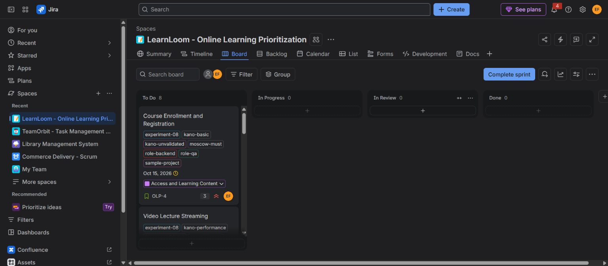
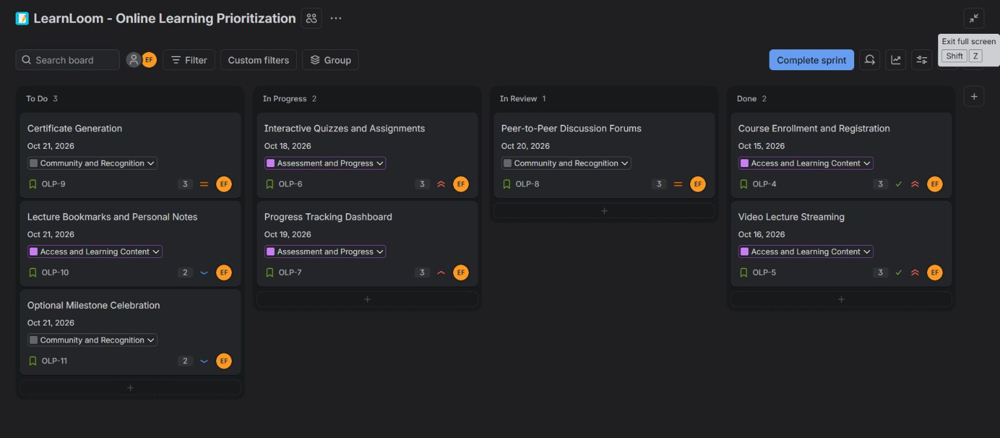
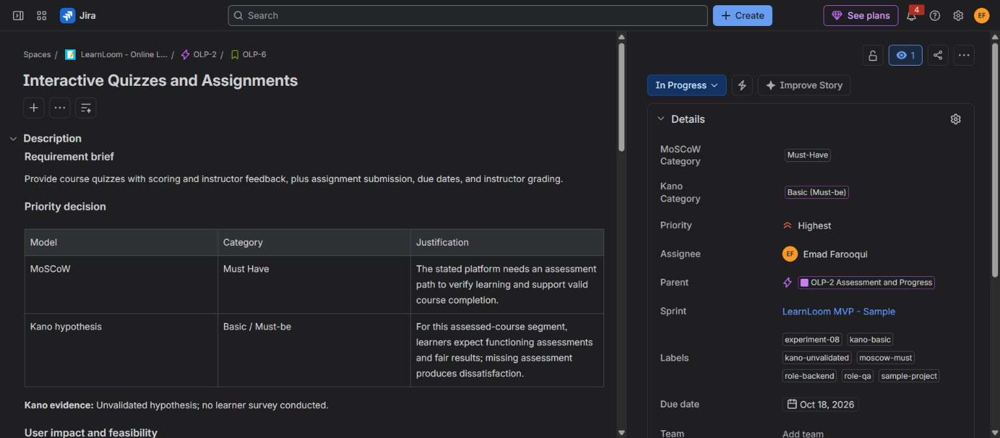
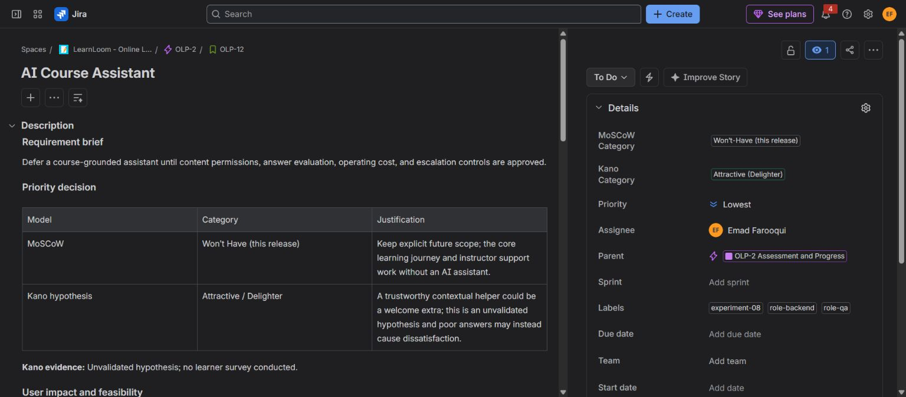
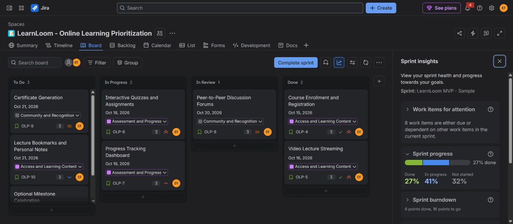
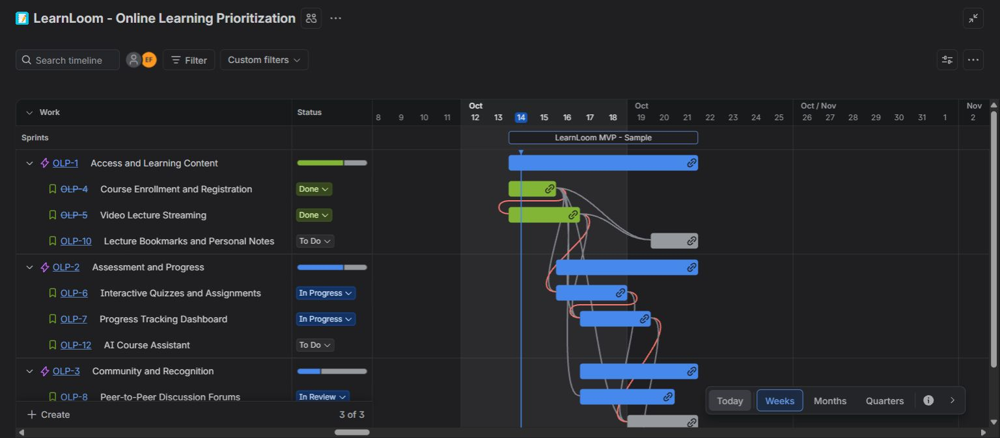
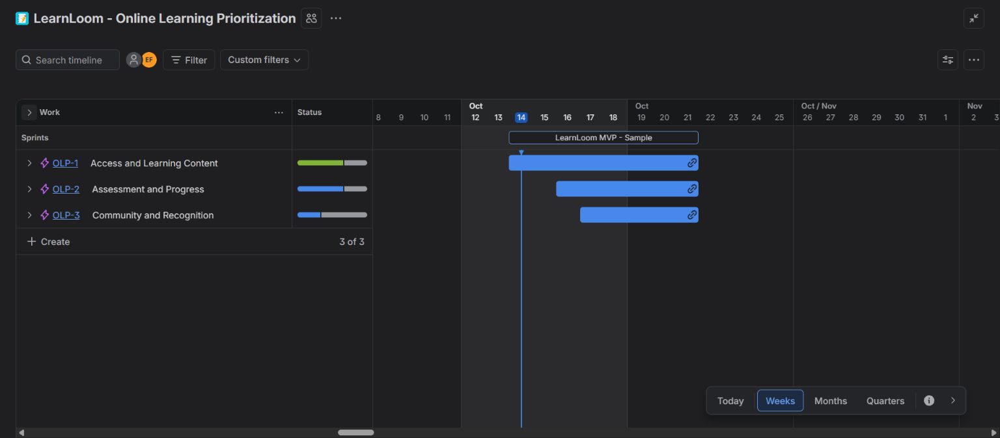
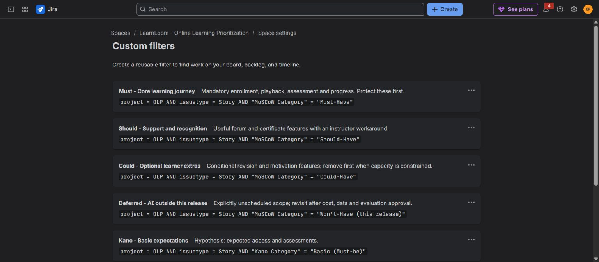
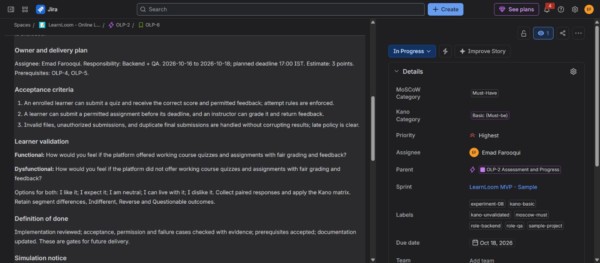

# Experiment 8: Online Learning Platform Prioritization using MoSCoW and Kano

## Aim

Categorize and prioritize the six required Online Learning Platform functionalities using MoSCoW release priorities and Kano satisfaction hypotheses in a unique, private Jira Scrum project.

## Tools Required

- Jira Cloud: private Scrum project, native model dropdowns, epics, stories, priorities, assignment, responsibility labels, estimates, deadlines, dependency links, backlog, sprint board, list, timeline, custom filters, and sprint insights.
- Browser for Jira interaction and screenshots.

## Algorithm

1. Create the private [LearnLoom - Online Learning Prioritization project (OLP)](https://emadfar2020.atlassian.net/jira/software/projects/OLP/list). Keep all six original functionality names explicit.
2. Organize requirements under three epics: [OLP-1: Access and Learning Content](https://emadfar2020.atlassian.net/browse/OLP-1), [OLP-2: Assessment and Progress](https://emadfar2020.atlassian.net/browse/OLP-2), and [OLP-3: Community and Recognition](https://emadfar2020.atlassian.net/browse/OLP-3).
3. Set native **MoSCoW Category** and **Kano Category** dropdowns independently from Jira Priority. MoSCoW defines first-release scope; Kano represents a satisfaction hypothesis requiring learner feedback.
4. Create the following nine stories. The first six are the original requirements; the final three make optional and deferred scope visible.

| Jira story | Requirement | MoSCoW | Kano hypothesis | Points |
|---|---|---|---|---:|
| [OLP-4](https://emadfar2020.atlassian.net/browse/OLP-4) | Course Enrollment and Registration | Must Have | Basic / Must-be | 3 |
| [OLP-5](https://emadfar2020.atlassian.net/browse/OLP-5) | Video Lecture Streaming | Must Have | Performance / One-dimensional | 3 |
| [OLP-6](https://emadfar2020.atlassian.net/browse/OLP-6) | Interactive Quizzes and Assignments | Must Have | Basic / Must-be | 3 |
| [OLP-7](https://emadfar2020.atlassian.net/browse/OLP-7) | Progress Tracking Dashboard | Must Have | Performance / One-dimensional | 3 |
| [OLP-8](https://emadfar2020.atlassian.net/browse/OLP-8) | Peer-to-Peer Discussion Forums | Should Have | Performance / One-dimensional | 3 |
| [OLP-9](https://emadfar2020.atlassian.net/browse/OLP-9) | Certificate Generation | Should Have | Performance / One-dimensional | 3 |
| [OLP-10](https://emadfar2020.atlassian.net/browse/OLP-10) | Lecture Bookmarks and Personal Notes | Could Have | Performance / One-dimensional | 2 |
| [OLP-11](https://emadfar2020.atlassian.net/browse/OLP-11) | Optional Milestone Celebration | Could Have | Attractive / Delighter | 2 |
| [OLP-12](https://emadfar2020.atlassian.net/browse/OLP-12) | AI Course Assistant | Won’t Have (this release) | Attractive / Delighter | 8 |

5. Save each story's scope, user impact, feasibility, both model rationales, three acceptance criteria, responsibility, estimates, prerequisites, paired Kano questions, and future definition of done. Assign all stories to **Emad Farooqui** and use **Frontend**, **Backend**, and **QA** responsibility labels; these represent planned responsibilities.
6. Start **LearnLoom MVP - Sample**, sprint **7**, for **14–21 October 2026** on the [OLP board](https://emadfar2020.atlassian.net/jira/software/projects/OLP/boards/5). Include **OLP-4 through OLP-11: eight stories and 22 points**. Leave **OLP-12** in the backlog with no sprint, start date, or due date. Scheduled stories have native dates and a planned **17:00 IST** deadline in their descriptions.
7. Add **16 native prerequisite links**. Every Must-Have depends only on other Must-Haves. Protect the 12-point core journey; remove the 4-point Could-Have scope first if capacity is constrained. Forums have a temporary instructor Q&A workaround, and certificates have a temporary completion-letter workaround. AI remains deferred because permissions, answer evaluation, privacy, and cost controls need further work.
8. Capture the initial sprint with **eight To Do stories**, then simulate a fictional **17 October checkpoint**: **3 To Do, 2 In Progress, 1 In Review, and 2 Done**. The sprint remains active. These statuses demonstrate workflow without establishing implemented software, actual employee work, completed QA, or stakeholder approval.
9. Save and test **seven native model filters**: Must, Should, Could, Deferred, Kano Basic, Kano Performance, and Kano Attractive. Each restricts results to OLP **Stories**. On the active sprint board, their results are **4, 2, 2, 0, 2, 5, and 1** stories respectively. Deferred returns zero there because AI is outside the sprint; the full list includes that additional Attractive story.
10. Show all **nine stories** in the list with Priority, Status, MoSCoW, and Kano fields. Configure the weekly timeline to use native dates, show completed work and dependencies, and display the three epic groups. Eight stories are scheduled; AI remains undated.
11. Verify saved descriptions, native fields, ownership, dates, estimates, epic parents, sprint membership, dependencies, filters, and progress. Completion is **2/8 = 25% by story count** or **6/22 = 27.3% by estimated points**. Jira rounds the point-based value to **27%**, with **6 points done and 16 remaining**. Exclude epics from story metrics.
12. Treat Kano classifications as **unvalidated hypotheses**. Use the saved functional and dysfunctional questions to collect real paired responses later, retaining segment differences and Indifferent, Reverse, or Questionable outcomes. Certificate Generation is provisionally Performance for the general/career learner pilot; credential-focused learners may classify it as Basic.

MoSCoW release-scope definitions follow the [Agile Business Consortium](https://www.agilebusiness.org/resource/what-is-moscow-prioritization/). The Kano distinction between expected, performance, and attractive quality follows [Kano et al. (1984)](https://www.jstage.jst.go.jp/article/quality/14/2/14_KJ00002952366/_article). The specific classifications above are sample planning judgments.

## Output Screenshots

1. **Sprint start:** Eight planned stories in To Do before the workflow simulation.

2. **Simulated checkpoint:** All eight sprint stories across To Do, In Progress, In Review, and Done.

3. **Requirement justification:** Saved assessment scope and model rationales alongside native classifications, priority, ownership, and sprint details.

4. **Deferred scope:** AI assistance is Won’t-Have for this release and an Attractive hypothesis, with no sprint or delivery dates.

5. **Sprint insights:** Native point-based progress rounds to 27%, with six points done and 16 points remaining.

6. **Priority matrix:** All nine stories with independent MoSCoW, Kano, Priority, and Status fields.

7. **Expanded timeline excerpt:** Dated work, completed stories, and dependency lines under the feature epics; some community stories are below the visible area.

8. **Timeline overview:** All three feature epics and the one-week sprint visible together.

9. **Custom filters excerpt:** Reusable Story-only filters use native model fields; seven filters were saved and tested.

10. **Acceptance and validation:** Planned ownership, prerequisites, three acceptance criteria, both Kano questions, response options, and future definition of done.

## Result

Created and verified a private Jira prioritization project with **3 epics, 9 detailed stories, 16 prerequisite links, 7 tested model filters, and an active one-week sample sprint**. All six requested functionalities remain explicit. The full requirement set contains **4 Must, 2 Should, 2 Could, and 1 Won’t for this release**, with **2 Basic, 5 Performance, and 2 Attractive Kano hypotheses**.

The eight-story sprint demonstrates **25% completion by count** and **27.3% by estimated points**. The list, timeline, board, filters, and insights provide traceable planning and progress views. This is a Jira requirements-prioritization experiment with simulated workflow; it does not establish a developed learning application or validated learner feedback.
