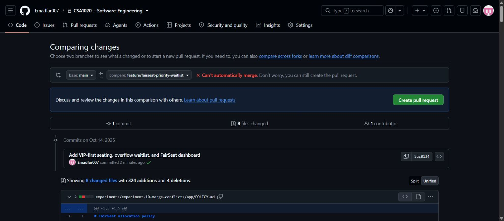
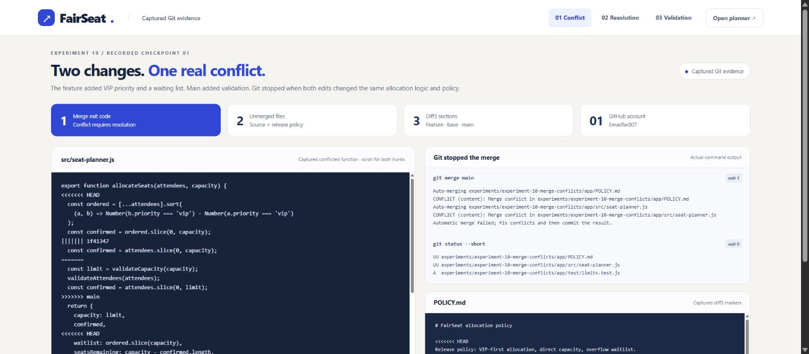
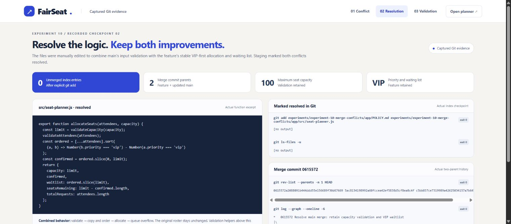
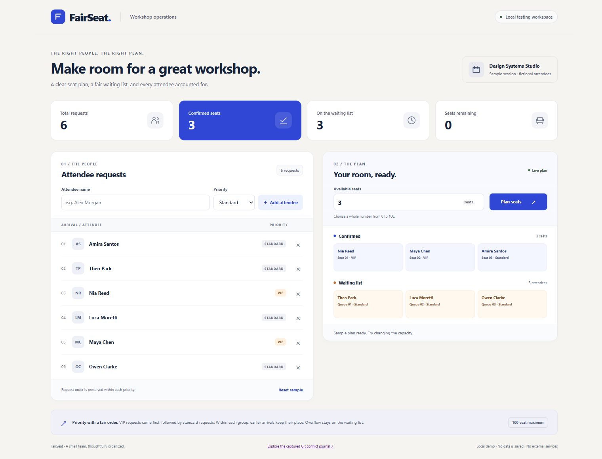
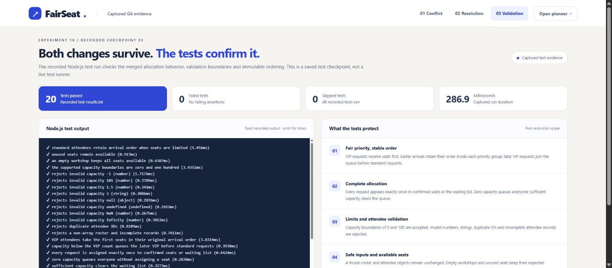
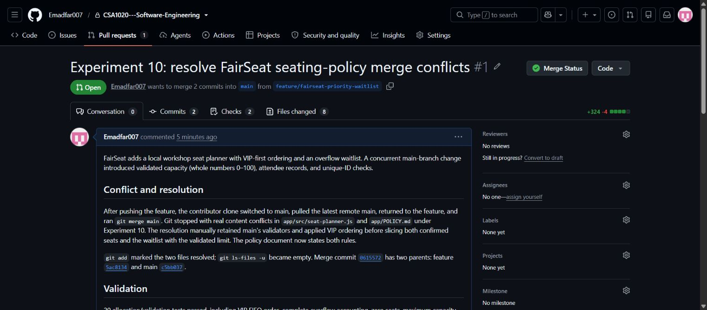
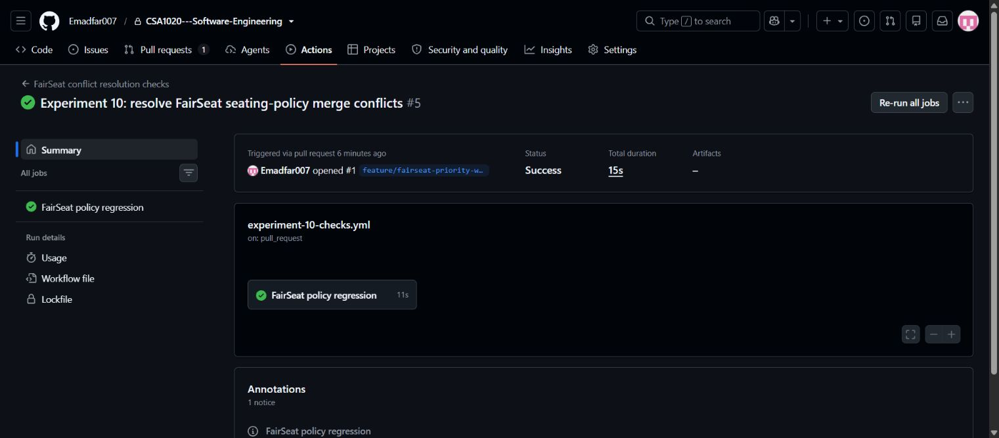
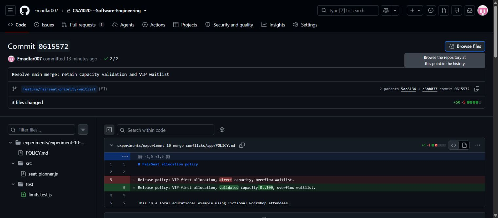
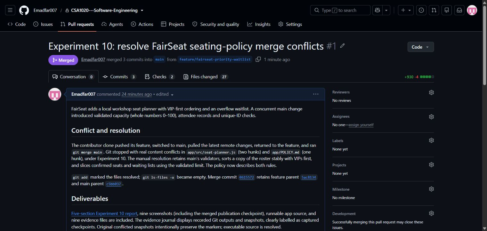

# Experiment 10: Resolving Git Merge Conflicts with FairSeat

## Aim

Demonstrate a real Git branch-and-merge conflict in the shared [CSA1020 Software Engineering repository](https://github.com/Emadfar007/CSA1020---Software-Engineering), manually combine both branches' requirements, verify the result, and open a pull request.

**Collaboration scope:** two fresh local clones represent contributor and maintainer roles, both using **Emadfar007**. The roles are simulated; Git actually generated the conflicts after intentionally overlapping concurrent edits. The conflict-resolution step merges **main into the feature branch**. The completed pull request was subsequently **merged into main** to publish this experiment.

## Tools Required

- Git and GitHub using Emadfar007.
- Two local repository clones for the contributor and maintainer roles.
- Node.js, npm, JavaScript, HTML, and CSS for the FairSeat workshop seat planner and tests.
- Browser for local workflow testing and native GitHub screenshots.
- Text editor for manual conflict resolution; GitHub Actions for remote checks.

## Algorithm

1. Clone the shared repository into two fresh working directories, representing contributor and maintainer roles. The actual clone commands were `git clone https://github.com/Emadfar007/CSA1020---Software-Engineering.git work/experiment-10-fairseat` and `git clone https://github.com/Emadfar007/CSA1020---Software-Engineering.git work/experiment-10-maintainer`. Confirm the origin URL. The repository revision before this exercise was `82d6c007f5f185e19b52405f2d11156ef5c4d384`.
2. Add the FairSeat baseline and workflow on main, commit [1f41347](https://github.com/Emadfar007/CSA1020---Software-Engineering/commit/1f413472d8fce6e6d8c859a8dae0de42334e0ce7), and push it. In the contributor clone, run `git switch -c feature/fairseat-priority-waitlist`.
3. Implement stable VIP-first seating, an overflow waitlist, and the local dashboard. Commit [5ac8134](https://github.com/Emadfar007/CSA1020---Software-Engineering/commit/5ac8134198992a60fccea42ef5838d5cf8ea0c4f), then run `git push -u origin feature/fairseat-priority-waitlist`. This feature push occurs before the concurrent main change.
4. In the maintainer clone, update the same allocation function and policy with integer capacity limits **0–100**, attendee validation, and unique IDs. Commit [c5bb037](https://github.com/Emadfar007/CSA1020---Software-Engineering/commit/c5bb037ce7319989a42625034157a7b647738bcc) and run `git push origin main`. Both branches now contain independent changes from the baseline.
5. In the contributor clone, run `git switch main` followed by `git pull --ff-only origin main` to obtain the concurrent main update.
6. Run `git switch feature/fairseat-priority-waitlist`, then `git merge main`. The recorded merge exits with **code 1**, reporting content conflicts in **two files**. Git leaves the merge unfinished for manual resolution.
7. Inspect `git status --short`, `git diff --name-only --diff-filter=U`, `git ls-files -u`, and `git diff --cc`. Both files are marked **UU**. Capture the real diff3 conflict markers before editing: two conflict hunks in the function file and one in the policy.
8. Manually replace the conflicting sections with a combined implementation. Preserve both branches' intent rather than selecting one whole side:

| Conflicted file | Feature branch intent | Concurrent main intent | Manual resolution |
|---|---|---|---|
| `app/src/seat-planner.js` | Stable VIP-first ordering and overflow waitlist | Validate integer capacity 0–100, attendee records, and unique IDs | Validate first; sort a copied roster stably with VIPs first; slice confirmed and waitlisted attendees using the validated limit; calculate remaining seats without mutating the input. |
| `app/POLICY.md` | Document VIP priority and waitlisting | Document validated capacity limits | Replace the conflicting policy line with one statement covering validated 0–100 capacity, stable VIP-first allocation, and overflow waitlisting. |

All paths above are relative to `experiments/experiment-10-merge-conflicts/`. Choosing the feature side alone would lose validation; choosing main alone would lose VIP priority and the waitlist. Git's [merge documentation](https://git-scm.com/docs/git-merge) and [conflict-resolution guide](https://git-scm.com/book/en/v2/Git-Branching-Basic-Branching-and-Merging) explain the paused merge, manual editing, staging, and final merge commit.

9. Stage the two manually resolved files with the actual command below. Confirm `git ls-files -u` returns no entries. This marks the conflicts resolved; the merge still needs a commit.

```bash
git add experiments/experiment-10-merge-conflicts/app/POLICY.md experiments/experiment-10-merge-conflicts/app/src/seat-planner.js
git ls-files -u
git diff --cached --check
```

10. Run the app's `npm test`: **20 tests pass, zero fail**. Syntax checks pass, and independent source inspection finds no issues. Verify **10 browser checkpoints**:

| Browser check | Verified outcome |
|---|---|
| Default three-seat plan | Nia Reed, Maya Chen, and Amira Santos confirmed; Theo Park, Luca Moretti, and Owen Clarke waitlisted |
| Capacity 4 | Four confirmed and two waitlisted |
| Capacity 101 | Validation error; the last valid four-seat plan remains |
| Add VIP Iris while capacity input is invalid | Allocation uses the last valid capacity of four seats |
| Capacity 3 with Iris | All three VIP attendees receive the three seats |
| Remove Iris | Six-person roster and corresponding allocation restored |
| Capacity 0 | All six attendees waitlisted |
| Capacity 100 | Six confirmed, none waitlisted, 94 seats remaining |
| Blank attendee name | Helpful error; no invalid attendee added |
| Reset | Six fictional sample attendees and three-seat capacity restored |

11. Complete the merge and push the resolved feature branch using the recorded commands:

```bash
git commit -m "Resolve main merge: retain capacity validation and VIP waitlist"
git rev-list --parents -n 1 HEAD
git log --graph --oneline -6
git push origin feature/fairseat-priority-waitlist
```

The integration commit is [0615572](https://github.com/Emadfar007/CSA1020---Software-Engineering/commit/0615572a2088091b444ddd55e156689f30d67669), with exactly two parents: feature commit `5ac8134198992a60fccea42ef5838d5cf8ea0c4f` and concurrent main commit `c5bb037ce7319989a42625034157a7b647738bcc`.
12. Open [pull request #1](https://github.com/Emadfar007/CSA1020---Software-Engineering/pull/1) from `feature/fairseat-priority-waitlist` into the shared repository's main and capture its open review checkpoint. Verify the successful [GitHub Actions run 38592879387](https://github.com/Emadfar007/CSA1020---Software-Engineering/actions/runs/38592879387), [job 115952031317](https://github.com/Emadfar007/CSA1020---Software-Engineering/actions/runs/38592879387/job/115952031317), at the captured resolved-code checkpoint `0615572a2088091b444ddd55e156689f30d67669`. The final feature head `9bf7c2b` also passes [run 38594673443](https://github.com/Emadfar007/CSA1020---Software-Engineering/actions/runs/38594673443). To publish the completed experiment, merge the PR using a merge commit, preserving the branch history. GitHub confirms publication merge [cf66b5b](https://github.com/Emadfar007/CSA1020---Software-Engineering/commit/cf66b5b9cef4ef4ab8472f16da5de1ebff400c27) on main. Capture the merged PR and add the final publication screenshot to this report.

**Captured evidence:** [actual command log](evidence/commands.jsonl), [conflicted function snapshot](evidence/conflicted-seat-planner.js.txt), [conflicted policy snapshot](evidence/conflicted-POLICY.md.txt), [resolved function snapshot](evidence/resolved-seat-planner.js.txt), [20-test output](evidence/test-results.txt), and [browser checkpoints](evidence/browser-verification.json). The static journal has three linked views: [conflict](evidence/conflict.html), [resolution](evidence/resolution.html), and [validation](evidence/validation.html). Journal navigation and returning to the planner were also verified.

**Run locally:** from the Experiment 10 directory, run `node app/scripts/serve.js`, then open [127.0.0.1:4831](http://127.0.0.1:4831/). The evidence journal is at [127.0.0.1:4831/evidence/](http://127.0.0.1:4831/evidence/). To run the tests, enter `app/` and run `node --test`. The deliverable includes the runnable `app/` source and nine evidence files. Evidence-viewer screenshots are explicitly labeled static captured Git checkpoints; they are not a live terminal or the current unresolved Git state.

## Output Screenshots

1. **GitHub conflict preview:** native GitHub reports that the diverged branches cannot be merged automatically before manual integration.



2. **Captured conflict checkpoint:** the static evidence journal presents the actual failed merge output and conflict markers.



3. **Manual resolution checkpoint:** the static journal shows how both branches' intent was preserved and the conflicts staged as resolved.



4. **Working FairSeat dashboard:** the resolved planner combines validated capacity, VIP priority, and an overflow waitlist.



5. **Validation checkpoint:** the static journal presents captured automated test and browser-check evidence.



6. **Open pull request checkpoint:** native GitHub shows the resolved feature proposed into main before publication. This historical capture precedes the merged state in screenshot 9.



7. **Passing remote checks:** native GitHub Actions shows success for the captured resolved-code checkpoint.



8. **Two-parent merge commit:** native GitHub shows the integration commit connecting the feature and concurrent main histories.



9. **Published to main:** native GitHub confirms that pull request #1 was merged, publishing the completed experiment while preserving the demonstrated conflict-resolution history.



## Result

Created a genuine merge conflict from concurrent changes in two working clones of the same shared repository. Manually resolved **two conflicted files and three conflict hunks** while preserving both validation and VIP/waitlist behavior. The resolved app passed **20 automated tests** and **10 browser checkpoints**, and the verified two-parent merge commit was pushed to the feature branch.

[PR #1](https://github.com/Emadfar007/CSA1020---Software-Engineering/pull/1) is **merged into main** at publication commit `cf66b5b9cef4ef4ab8472f16da5de1ebff400c27`. GitHub Actions passed for both the captured resolved-code checkpoint `0615572` and final feature head `9bf7c2b`. The runnable app, nine evidence files, and **nine screenshots** document the conflict, manual resolution, validation, open review checkpoint, and completed publication. Experiments 1–9 are unchanged. Both local roles use Emadfar007, and the sample attendee names are fictional.
