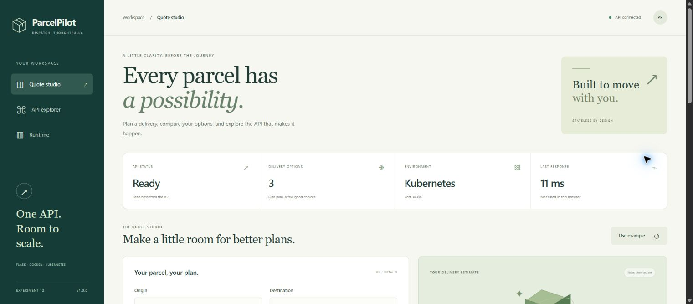
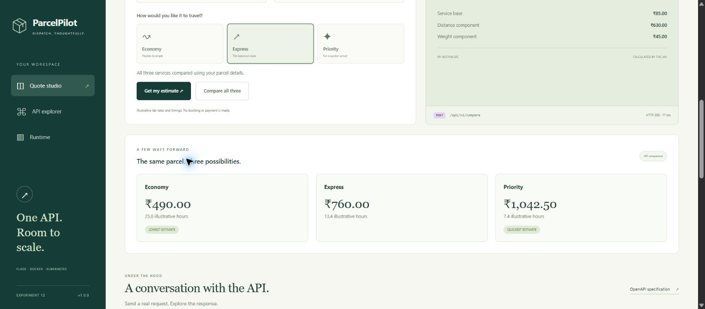
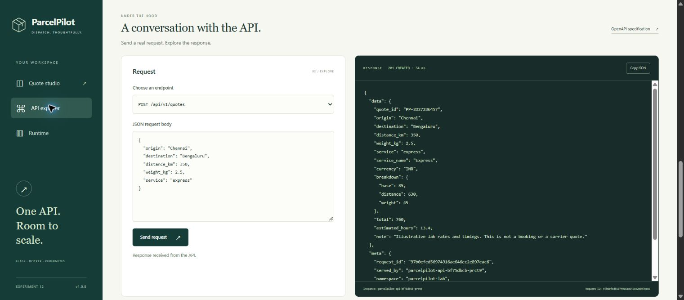
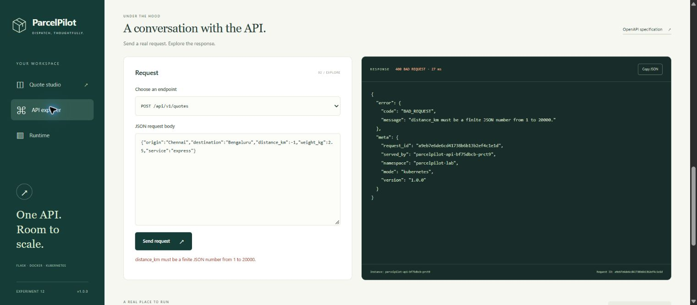
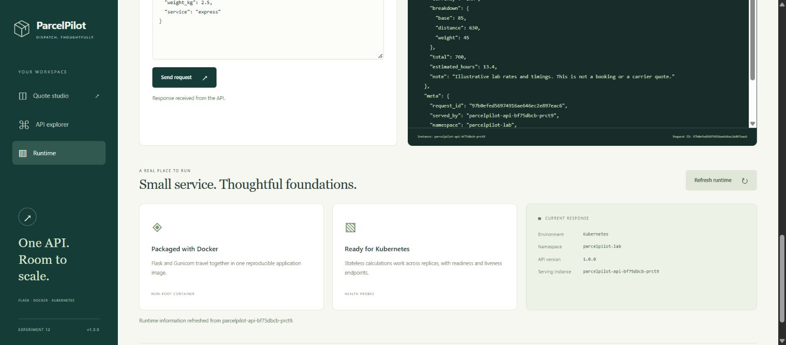
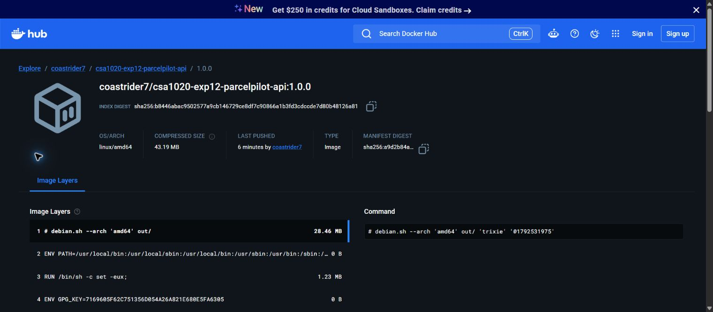
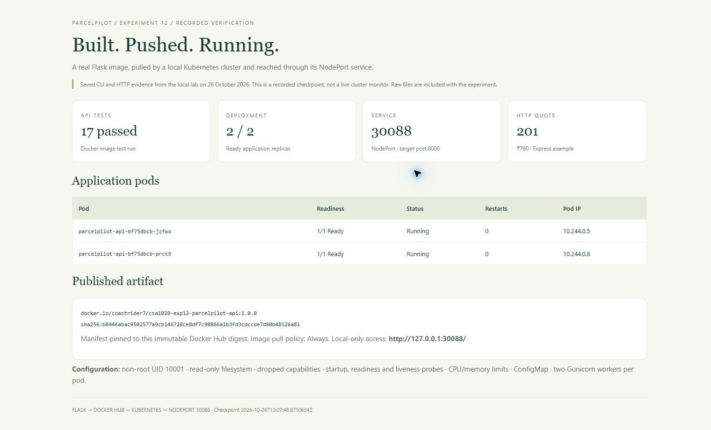
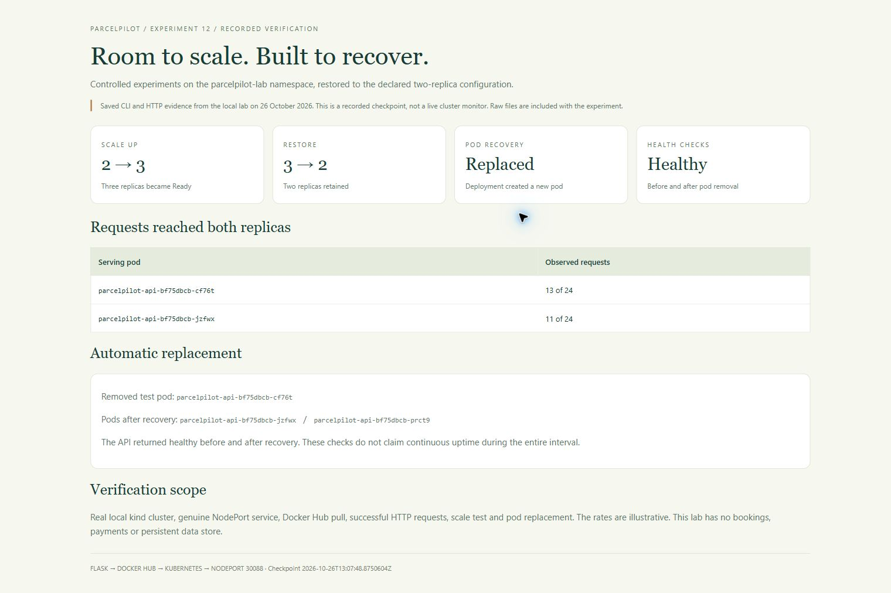

# Experiment 12 — ParcelPilot: Flask API with Docker and Kubernetes

## Aim

To develop a distinctive Python Flask delivery-estimate API, package it using Docker, publish the image to Docker Hub, and deploy it to a local Kubernetes cluster using a NodePort service. The browser workbench makes requests to the same API so the complete workflow can be demonstrated.

## Tools Required

| Tool | Purpose |
|---|---|
| Python 3.13 in a Linux container | Application runtime |
| Flask 3.1.3 and Gunicorn 26.2.0 | JSON endpoints and application server |
| Docker Desktop, Docker CLI and Docker Hub | Build, run and publish the container image |
| kind 0.33.0, Kubernetes 1.36.4 and kubectl | Local cluster, Deployment and NodePort Service |
| PowerShell and Chrome | Commands, HTTP verification and browser workflow |
| HTML, CSS and JavaScript | Self-contained interactive API workbench |

Docker Hub image: [coastrider7/csa1020-exp12-parcelpilot-api:1.0.0](https://hub.docker.com/r/coastrider7/csa1020-exp12-parcelpilot-api/tags).

Local Kubernetes app: [http://127.0.0.1:30088/](http://127.0.0.1:30088/). Standalone Docker preview: [http://127.0.0.1:8088/](http://127.0.0.1:8088/). These addresses work on the computer running the lab while Docker and the cluster are running.

### Quick access links

| What to open | Link |
| --- | --- |
| Open the Kubernetes application | [ParcelPilot - NodePort app](http://127.0.0.1:30088/) |
| Use the application sections | [Quote workbench](http://127.0.0.1:30088/#workbench) · [API explorer](http://127.0.0.1:30088/#explorer) · [Runtime details](http://127.0.0.1:30088/#runtime) |
| Open the standalone Docker application | [ParcelPilot - Docker preview](http://127.0.0.1:8088/) |
| Inspect the API | [OpenAPI specification](http://127.0.0.1:30088/openapi.json) · [Runtime status JSON](http://127.0.0.1:30088/api/v1/status) · [Health check](http://127.0.0.1:30088/healthz) |
| Find the published image | [Docker Hub image and tags](https://hub.docker.com/r/coastrider7/csa1020-exp12-parcelpilot-api/tags) |
| Source and deployment files | [Experiment folder](https://github.com/Emadfar007/CSA1020---Software-Engineering/tree/main/experiments/experiment-12-flask-docker-kubernetes) · [Dockerfile](https://github.com/Emadfar007/CSA1020---Software-Engineering/blob/main/experiments/experiment-12-flask-docker-kubernetes/Dockerfile) · [Kubernetes manifests](https://github.com/Emadfar007/CSA1020---Software-Engineering/tree/main/experiments/experiment-12-flask-docker-kubernetes/k8s) |
| View the output | [All nine screenshots](https://github.com/Emadfar007/CSA1020---Software-Engineering/tree/main/experiments/experiment-12-flask-docker-kubernetes/screenshots) · [Verification evidence](https://github.com/Emadfar007/CSA1020---Software-Engineering/tree/main/experiments/experiment-12-flask-docker-kubernetes/evidence) |
| Open the experiment collection | [All experiments](https://github.com/Emadfar007/CSA1020---Software-Engineering) |

The application links are local to the computer running Docker Desktop. Start the existing demos with `docker start parcelpilot-lab-control-plane parcelpilot-api-exp12` if needed. Port 30088 opens the Kubernetes deployment; port 8088 opens the standalone Docker container.

## Algorithm

1. Create [app.py](app.py) with a Flask application factory, JSON envelopes, validation, request IDs and runtime metadata. Design the browser quote studio, API explorer and runtime panel using local assets. Use illustrative parcel delivery rates; perform no real bookings or payments.
2. Implement the following endpoints:

| Method and endpoint | Purpose |
|---|---|
| GET / | Browser workbench |
| GET /healthz and GET /readyz | Liveness and readiness |
| GET /api/v1/status | Version, environment, namespace and serving instance |
| GET /api/v1/services | List, filter by max_base_fee and sort services |
| GET /api/v1/services/{code} | Individual service details |
| POST /api/v1/quotes | Validate parcel details and return an estimate with HTTP 201 |
| POST /api/v1/compare | Compare three delivery options |
| GET /api/v1/examples | Example payloads |
| GET /openapi.json | OpenAPI 3.1 specification |

3. Calculate each estimate as base charge + distance × distance rate + weight × weight rate. Round currency to two decimal places. For Chennai to Bengaluru, 350 km and 2.5 kg, Express costs ₹85 + ₹630 + ₹45 = **₹760**. Economy costs **₹490**, and Priority costs **₹1,042.50**. Reject missing fields, unknown fields, invalid services, same-city routes, malformed JSON, booleans used as numbers, non-finite values and values outside the permitted ranges.
4. Create [requirements.txt](requirements.txt), [Dockerfile](Dockerfile) and [.dockerignore](.dockerignore). Build from Python 3.13 slim, install pinned Flask/Gunicorn versions, use UID 10001 and run two Gunicorn workers on port 8000. Include a Docker health check.
5. Build the image and run the API tests inside it. From this experiment directory, with Docker on PATH:

```powershell
docker build --pull --progress=plain -t coastrider7/csa1020-exp12-parcelpilot-api:1.0.0 .
$labTests = Join-Path (Get-Location) 'tests'
docker run --rm --mount "type=bind,source=$labTests,target=/tests,readonly" coastrider7/csa1020-exp12-parcelpilot-api:1.0.0 python -m unittest discover -s /tests -v
```

The recorded run passed **17 tests**, including price calculation, service comparison, stateless behavior, boundaries, numeric validation, JSON transport errors, routes, headers and specification checks. See [test output](evidence/api-tests.txt).

6. Run the standalone container with a read-only filesystem and local port binding:

```powershell
docker run -d --name parcelpilot-api-exp12 --read-only --tmpfs /tmp:rw,noexec,nosuid,size=16m --cap-drop ALL --security-opt no-new-privileges:true -p 127.0.0.1:8088:8000 coastrider7/csa1020-exp12-parcelpilot-api:1.0.0
./scripts/verify.ps1 -BaseUrl http://127.0.0.1:8088
```

7. Sign in to Docker Hub yourself using Docker's device flow, then push the image. The account used for this experiment was **coastrider7**. Passwords, tokens and kubeconfig files are excluded from the submission.

```powershell
docker login
docker push coastrider7/csa1020-exp12-parcelpilot-api:1.0.0
```

Verify the tag on Docker Hub. Published index digest: `sha256:b8446abac9502577a9cb146729ce8df7c90866a1b3fd3cdccde7d80b48126a81`. The Linux AMD64 child image has its own platform digest; this differs from the index digest. See [push output](evidence/docker-push.txt) and [Hub tag metadata](evidence/dockerhub-tag.json).

8. Install kind from its [official release](https://kind.sigs.k8s.io/docs/user/quick-start/). For a fresh computer without this lab cluster, create it using the supplied [cluster configuration](cluster/kind-config.yaml):

```powershell
kind create cluster --name parcelpilot-lab --config cluster/kind-config.yaml --wait 180s
```

The supplied configuration maps local loopback port 30088 to node port 30088. This is a real NodePort connection into the kind node, rather than kubectl port-forward. The cluster is local and has one control-plane node.

9. Create [namespace.yaml](k8s/namespace.yaml), [configmap.yaml](k8s/configmap.yaml), [deployment.yaml](k8s/deployment.yaml) and [service.yaml](k8s/service.yaml). Configure two replicas, the published image pinned by digest, imagePullPolicy Always, startup/readiness/liveness probes, CPU/memory requests and limits, non-root execution, a read-only filesystem, dropped capabilities and an emptyDir for temporary files. Supply environment, pod name and namespace through ConfigMap and downward API fields.
10. Apply the namespace first, then the remaining manifests, and wait for the rollout. The helper performs this exact order and checks exit codes:

```powershell
./scripts/deploy.ps1
./scripts/verify.ps1
kubectl --context kind-parcelpilot-lab -n parcelpilot-lab get deployment,pods,service -o wide
```

11. Open http://127.0.0.1:30088/. Edit cities, distance and weight, choose any service, request an estimate, compare all options and use the example reset. In API explorer, select an endpoint, edit POST JSON, send a request and copy the response. A negative distance produces a clear HTTP 400; malformed editor JSON is caught before submission. Refresh Runtime to inspect the serving pod.
12. Send 24 independent status requests; both replicas respond (13 and 11 requests in the recorded sample). Scale the deployment from two to three replicas, wait until three are Ready, then restore it to two. Remove one named test pod in this namespace and wait for the Deployment to replace it. Health checks before and after recovery pass. These checks demonstrate replacement; they do not measure uninterrupted service throughout the interval. Raw evidence: [routing](evidence/replica-routing.json), [three-replica state](evidence/scale-three-replicas.txt), [pod replacement](evidence/self-healing.json).
13. Confirm the final state is two Ready pods, NodePort 30088 and two service endpoints. Capture the browser, registry and recorded CLI checkpoints. Preserve Experiment 11's container on port 8087. Keep this local deployment available for testing.

Reference documentation: [Flask with Gunicorn](https://flask.palletsprojects.com/en/stable/deploying/gunicorn/), [Docker image push](https://docs.docker.com/reference/cli/docker/image/push/), [Kubernetes Services](https://kubernetes.io/docs/concepts/services-networking/service/), [kind port mappings](https://kind.sigs.k8s.io/docs/user/configuration/).

## Output Screenshots

**1. Kubernetes workspace**

Live browser UI shows Kubernetes mode, Ready status and NodePort 30088.



**2. Delivery quote**

POST /api/v1/quotes returns HTTP 201 and the ₹760 Express estimate with a price breakdown.


**3. Service comparison**

One parcel compared across Economy, Express and Priority, with cheapest and quickest options.



**4. Interactive API explorer**

Editable JSON request and actual successful JSON response from a Kubernetes pod.



**5. Input validation**

Negative distance returns HTTP 400 with a clear error and request metadata.



**6. Runtime identity**

Namespace, version and actual serving pod are fetched from the deployed API.



**7. Docker Hub publication**

The image is published under coastrider7 with tag 1.0.0 and Linux AMD64 architecture.



**8. Deployment checkpoint**

Recorded CLI/HTTP checkpoint showing two Ready pods, NodePort, immutable image digest and test results.



**9. Scaling and recovery checkpoint**

Recorded evidence of replica routing, scale up/down and automatic replacement of a removed test pod.



The checkpoint images are browser captures of clearly labelled recorded evidence pages generated from the included CLI/HTTP files. Application and Docker Hub images are actual UI screenshots.

## Result

ParcelPilot was built and run with Docker, pushed to Docker Hub, pulled and deployed by Kubernetes, and accessed successfully through NodePort **30088**. The final Deployment has **2/2 Ready replicas**, both service endpoints are present, and the sample POST returns **HTTP 201 with ₹760**. All **17 API tests** passed. Browser quote generation, comparison, editable JSON requests, JSON copying, validation messages and runtime refresh were exercised. Scaling to three replicas and automatic replacement of a removed pod succeeded; the final replica count is two.

The application is an educational stateless delivery-estimate API with illustrative rates. It does not persist quotes, book deliveries, process payments, or claim production readiness. The API remains local to this computer; only its container image was published to Docker Hub as required.
