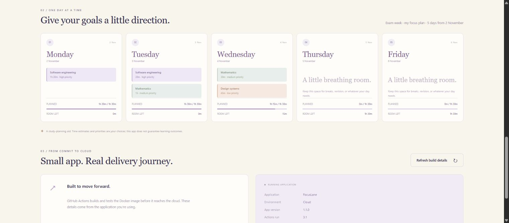
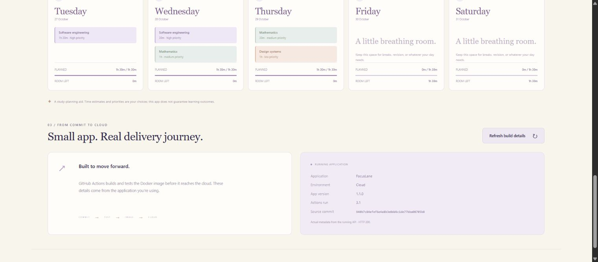
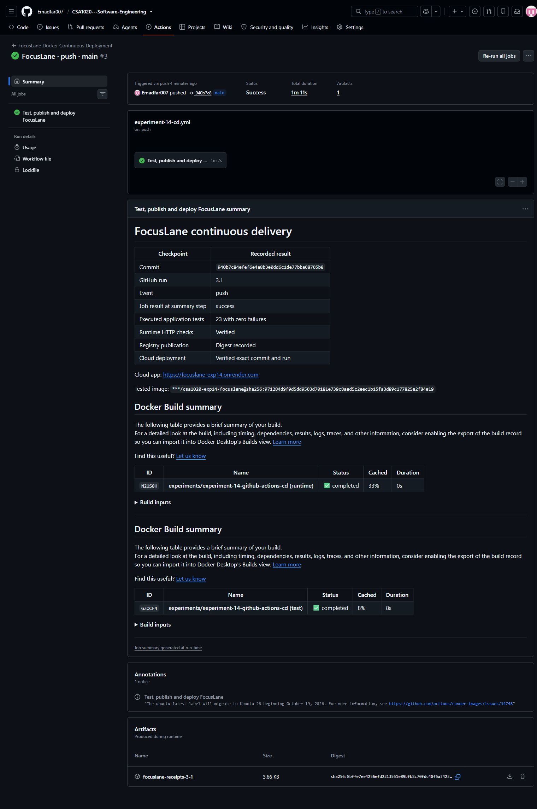
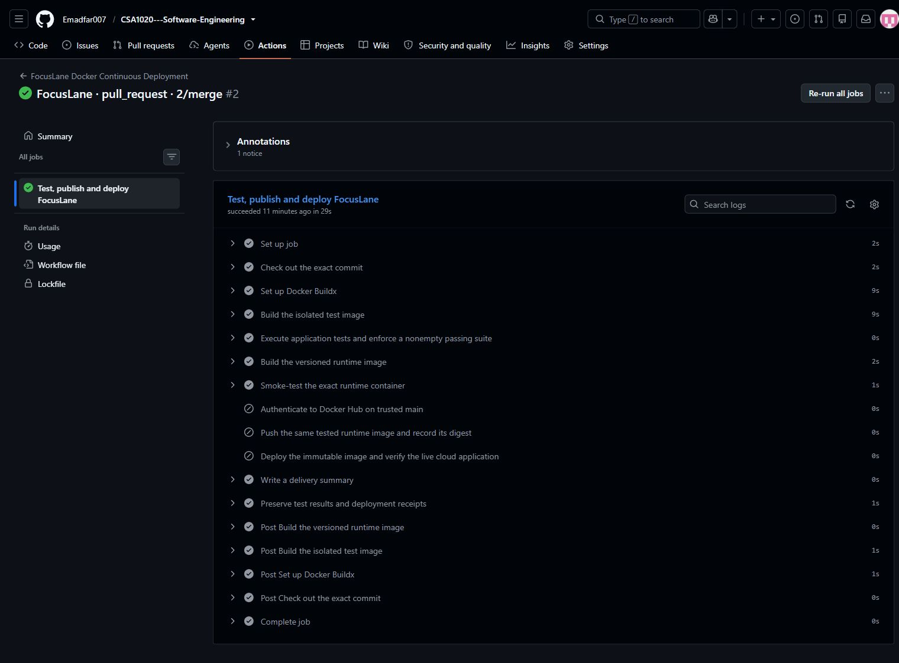
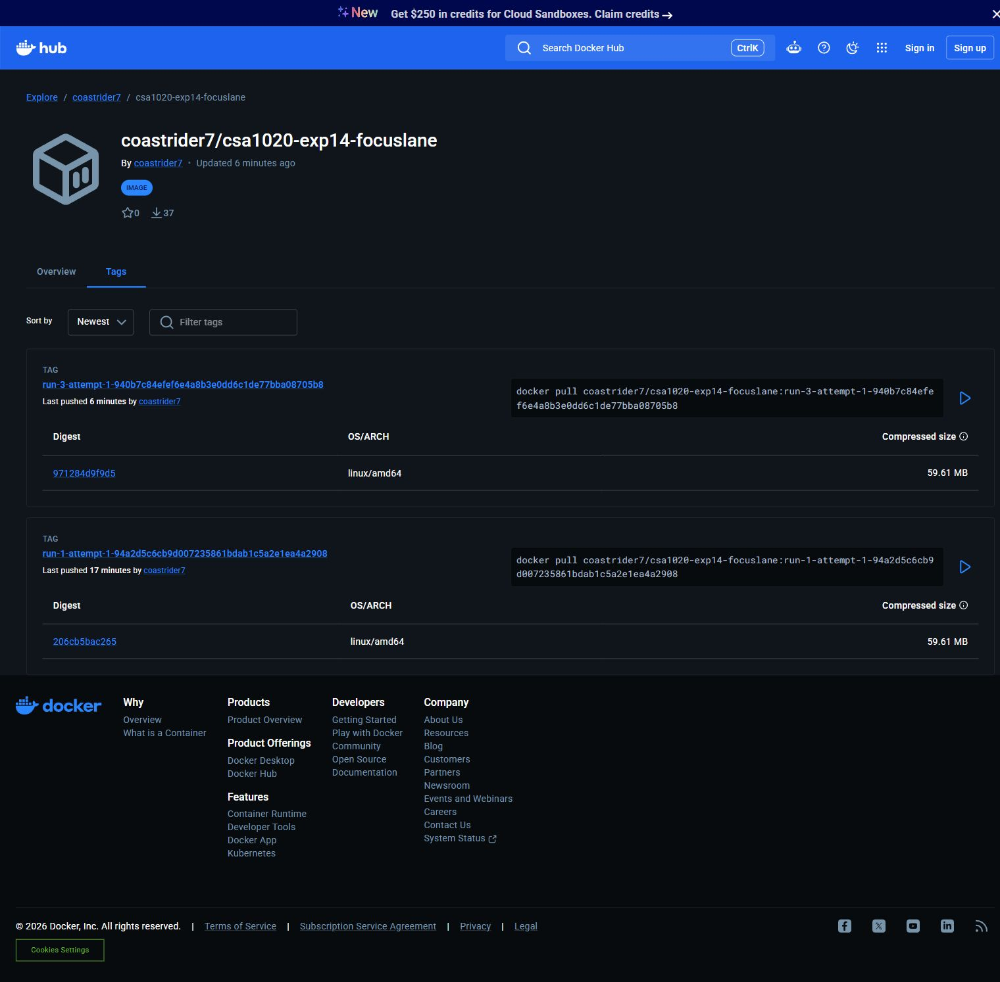

# Experiment 14 — FocusLane: Continuous Deployment with GitHub Actions

## Aim

To demonstrate continuous deployment of **FocusLane**, a Dockerized study-sprint planner, using GitHub Actions to test the application, publish its tested image to Docker Hub, and automatically deploy the same image to Render after application code reaches `main`.

## Tools Required

| Tool | Purpose |
|---|---|
| Git and GitHub | Source control, feature branch, pull request and merge history |
| GitHub Actions | Hosted automation for application pushes and pull requests |
| Docker and Buildx | Separate test/runtime images, container execution and build caching |
| Docker Hub | Versioned image publication and immutable registry digests |
| Node.js 24 | Dependency-free HTTP application and application tests |
| Python standard library | Test-report gate, HTTP verification and delivery receipts |
| Render Free web service | Cloud deployment of the published Docker image |
| Web browser | Functional testing and screenshots of actual results |

**Project:** [CSA1020 Software Engineering](https://github.com/Emadfar007/CSA1020---Software-Engineering/tree/main/experiments/experiment-14-github-actions-cd) · **Live application:** [FocusLane](https://focuslane-exp14.onrender.com) · **Images:** [Docker Hub](https://hub.docker.com/r/coastrider7/csa1020-exp14-focuslane/tags)

The service uses Render's **Free** plan without a database, persistent disk or paid add-on. The current Free web-service offering has no fixed trial-expiry date, but sleeps after 15 minutes without inbound traffic and uses the workspace's shared allowance of 750 instance hours each month. Usage limits and service policies apply; unlimited permanent hosting is not guaranteed. A sleeping service can take time to respond on its next visit. See [Render Free services](https://render.com/docs/free).

### Quick access links

| What to open | Link |
| --- | --- |
| Open the deployed application | [FocusLane - cloud app](https://focuslane-exp14.onrender.com/) |
| Check the deployed build | [Version and source JSON](https://focuslane-exp14.onrender.com/api/version) · [Health check](https://focuslane-exp14.onrender.com/healthz) |
| Follow the automatic pipeline | [GitHub Actions workflow](https://github.com/Emadfar007/CSA1020---Software-Engineering/actions/workflows/experiment-14-cd.yml) · [Recorded successful deployment run #3](https://github.com/Emadfar007/CSA1020---Software-Engineering/actions/runs/40353497794) |
| Review the code change that triggered deployment | [Merged feature pull request #2](https://github.com/Emadfar007/CSA1020---Software-Engineering/pull/2) |
| Find the published images | [Docker Hub image and tags](https://hub.docker.com/r/coastrider7/csa1020-exp14-focuslane/tags) |
| Manage the deployed service | [Render dashboard - sign-in required](https://dashboard.render.com/web/srv-dbfnbggm7kps739nrok0) |
| Source and pipeline configuration | [Experiment folder](https://github.com/Emadfar007/CSA1020---Software-Engineering/tree/main/experiments/experiment-14-github-actions-cd) · [Dockerfile](https://github.com/Emadfar007/CSA1020---Software-Engineering/blob/main/experiments/experiment-14-github-actions-cd/Dockerfile) · [Active workflow YAML](https://github.com/Emadfar007/CSA1020---Software-Engineering/blob/main/.github/workflows/experiment-14-cd.yml) |
| View the output | [All ten screenshots](https://github.com/Emadfar007/CSA1020---Software-Engineering/tree/main/experiments/experiment-14-github-actions-cd/screenshots) · [Automatic deployment evidence](https://github.com/Emadfar007/CSA1020---Software-Engineering/tree/main/experiments/experiment-14-github-actions-cd/evidence/automatic-deployment) |
| Open the experiment collection | [All experiments](https://github.com/Emadfar007/CSA1020---Software-Engineering) |

The cloud app opens from any device, and GitHub Actions runs on hosted runners. Render management requires sign-in. A sleeping Render Free app can take time to wake. The run #3 link preserves the successful experiment demonstration; the workflow link shows newer runs when present.

## Algorithm

1. **Create FocusLane.** Provide editable plan names, start dates, daily time budgets, plan lengths and one to six subjects. Each subject has a name, target duration and priority. The API schedules higher-priority work first without exceeding daily capacity. Display schedules, remaining work and capacity warnings; support saving drafts, resetting and exporting JSON.

2. **Containerize the application.** Use the supplied [Dockerfile](Dockerfile) with a digest-pinned Node.js 24 Alpine base, separate `test` and `runtime` targets, a non-root user and an HTTP health check. Bind the server to `0.0.0.0` and read the cloud-provided `PORT`. From a folder without an existing checkout of this name, these PowerShell commands create a fresh clone and reproduce local testing and execution:

   ```powershell
   git clone https://github.com/Emadfar007/CSA1020---Software-Engineering.git
   cd CSA1020---Software-Engineering/experiments/experiment-14-github-actions-cd
   docker build --target test --tag focuslane-tests:local .
   docker run --rm --network none --read-only --tmpfs /tmp focuslane-tests:local
   docker build --target runtime --tag focuslane:local .
   docker run --rm --publish 127.0.0.1:8000:8000 --env APP_MODE=local focuslane:local
   ```

   Visit [localhost:8000](http://127.0.0.1:8000). Docker assigns the container a name, avoiding a fixed-name collision. Use another host port if 8000 is occupied; press Ctrl+C to stop this temporary container.

3. **Install the workflow.** Push the application under `experiments/experiment-14-github-actions-cd` and install the supplied [workflow](workflow/experiment-14-cd.yml) as `.github/workflows/experiment-14-cd.yml` at the repository root. Application, CI-helper, Dockerfile and workflow changes trigger it; report and screenshot changes do not redeploy the application.

4. **Configure deployment settings.** Store registry credentials in the GitHub Actions secrets `EXP14_DOCKERHUB_USERNAME` and `EXP14_DOCKERHUB_TOKEN`. Bootstrap a separate Render Free image-backed service, save its service-specific hook as `EXP14_RENDER_DEPLOY_HOOK`, and set the variables `EXP14_RENDER_SERVICE_ID` and `EXP14_CLOUD_READY=true`. Credential values are excluded from source, screenshots and receipts. See [GitHub Actions secrets](https://docs.github.com/en/actions/how-tos/write-workflows/choose-what-workflows-do/use-secrets).

5. **Validate pull requests.** Check out the exact source, build the test image and run **23 application tests** plus **four CI guard tests**. Reject empty, all-skipped, failing or malformed application reports. Build the versioned runtime image and test its actual HTTP API in a restricted container. Pull requests skip registry authentication, publication and cloud deployment.

6. **Publish after a trusted `main` push.** Embed the commit SHA and `run_number.run_attempt` identity in the runtime. Smoke-test it, then push that same tested image under a unique tag and record its digest. See Docker's [test-before-push pattern](https://docs.docker.com/build/ci/github-actions/test-before-push/).

7. **Deploy and verify the exact image.** The workflow calls the Render hook with `imageRepository@sha256:digest`. Wait until the cloud API reports the expected commit and run identity, then check `/healthz`, `/api/version`, a valid study plan and HTTP 400 for invalid input. The fixed three-day example must allocate 255 minutes as `[90, 90, 75]`, with high-priority work first. See [Render deploy hooks](https://render.com/docs/deploy-hooks).

8. **Prove deployment through a real change.** Version 1.0.0 was bootstrapped from the first published image. Create `feature/focuslane-room-left`, add server-calculated `freeMinutes` and a **Room left** label on each schedule day, and update the app to 1.1.0. Push [pull request #2](https://github.com/Emadfar007/CSA1020---Software-Engineering/pull/2). Its [validation run](https://github.com/Emadfar007/CSA1020---Software-Engineering/actions/runs/40352441673) passed while publication and deployment were skipped. The repository owner merged the checked feature; a separate person's approval is not claimed.

9. **Confirm automatic delivery.** The merge's `main` push triggered [run 3](https://github.com/Emadfar007/CSA1020---Software-Engineering/actions/runs/40353497794), which tested, published and deployed version 1.1.0 automatically. Compare cloud identities before and after, exercise the interface, and preserve screenshots and machine-readable evidence. No manual workflow dispatch or manual cloud redeployment was used for this feature release.

The workflow uses commit-pinned actions, read-only repository permissions, caching, a bounded timeout and serialized `main` deliveries. It publishes a delivery summary and retains verification artifacts for seven days; submitted evidence copies remain in this repository. The standard GitHub-hosted runner works independently of the local computer or Jenkins. Runner, artifact and cache allowances remain subject to [GitHub Actions billing rules](https://docs.github.com/en/billing/concepts/product-billing/github-actions).

## Output Screenshots

**1. Original cloud version.** Version 1.0.0, run 1.1, was recorded before the feature merge.


**2. Deployed planner.** Editable subjects, priorities, dates and daily budgets in the cloud application.


**3. Delivered feature.** Generated schedule cards display Room left using the API's capacity calculation.



**4. Updated build identity.** The running API reports version 1.1.0, run 3.1 and the merged source commit.



**5. Automatic delivery result.** Successful Actions run triggered by the `main` push.



**6. Executed pipeline.** Tests, runtime checks, registry publication and cloud verification.


**7. Pull request validation.** The feature is tested while publication and deployment are skipped.



**8. Feature merge.** The pull request records the change used to test deployment.


**9. Cloud deployment.** Render's live image-backed service and pipeline-initiated deployment.

Render's banner refers to its registry auto-deploy setting after selecting a specific digest. GitHub Actions performs the deployment explicitly through the hook; the new live deployment is marked **Deploy Hook** below.


**10. Published image.** Docker Hub records the runtime's unique tag and registry digest.



The [delivery receipt](evidence/automatic-deployment/focuslane-receipts-3-1/delivery-receipt.json), [before](evidence/cloud-before.json) and [after](evidence/cloud-after.json) cloud responses, [browser export](evidence/browser-export.json), and [stale-plan export](evidence/browser-stale-export.json) provide the corresponding machine-readable evidence.

## Result

**Continuous deployment was demonstrated successfully on 26 October 2026.** Merging the Room left feature triggered GitHub Actions automatically. Run 3 passed, pushed the tested image and deployed it through Render's hook. The public application served the expected source commit and build identity, and its cloud HTTP checks passed.

| Verification | Before the feature | After automatic deployment |
|---|---|---|
| Application version | 1.0.0 | **1.1.0** |
| Actions run/attempt | 1.1 | **3.1** |
| Source commit | `94a2d5c6cb9d007235861bdab1c5a2e1ea4a2908` | `940b7c84efef6e4a8b3e0dd6c1de77bba08705b8` |
| Daily capacity display | Planned time | Planned time and **Room left** |
| Application tests | 22 passing | **23 executed, zero failures, zero skipped** |
| Cloud API checks | Original identity recorded | Health 200; plan 200; invalid input 400 |
| Deployment | Initial bootstrap | `dep-dbfnegvavr4c73fel0gg` — **live**, triggered by deploy hook |

Four CI guard tests also passed. The verified published and deployed image is:

```text
coastrider7/csa1020-exp14-focuslane@sha256:971284d9f9d5dd9503d70181e739c8aad5c2eec1b15fa3d89c177825e2f84e19
```

Browser verification confirmed the one-to-six-subject limits, add/remove controls, editable names and dates, priority ordering, capacity warnings, draft saving and restoration, reset, export, navigation and build refresh. A custom five-day plan starting 2 November allocated 255 minutes at 57% utilization and showed Room left values `[0, 0, 15, 90, 90]`. An over-capacity plan scheduled high-priority Operating systems first and clearly reported 285 unallocated minutes. A 29-minute daily limit produced the specific 30–480-minute validation error and re-enabled submission. Exporting an edited, ungenerated plan correctly returned `schedule: null` instead of attaching stale results. Resetting and reloading restored the sample and cleared the saved draft.

FocusLane remains an educational planning aid. Time estimates and priorities are user choices and do not guarantee learning outcomes.
