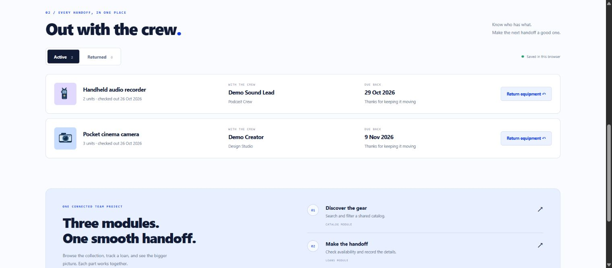
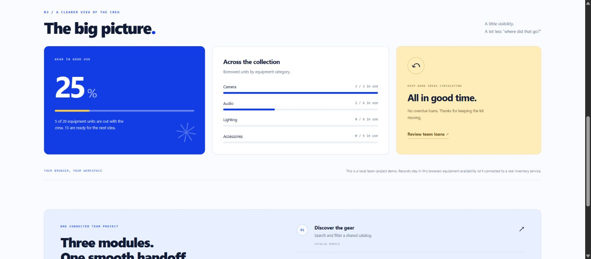
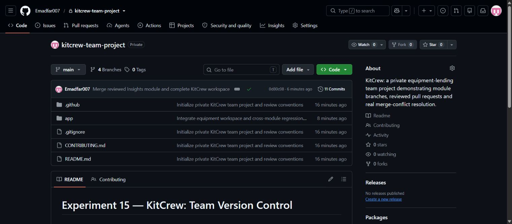
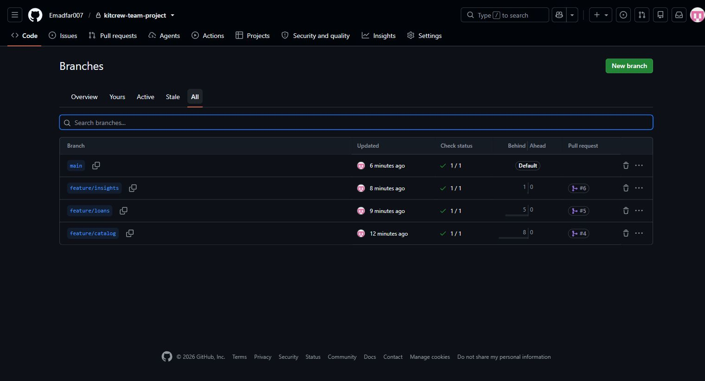
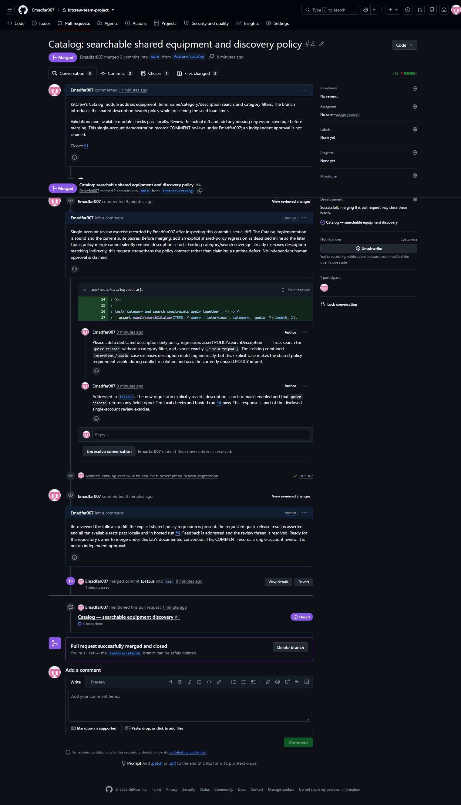
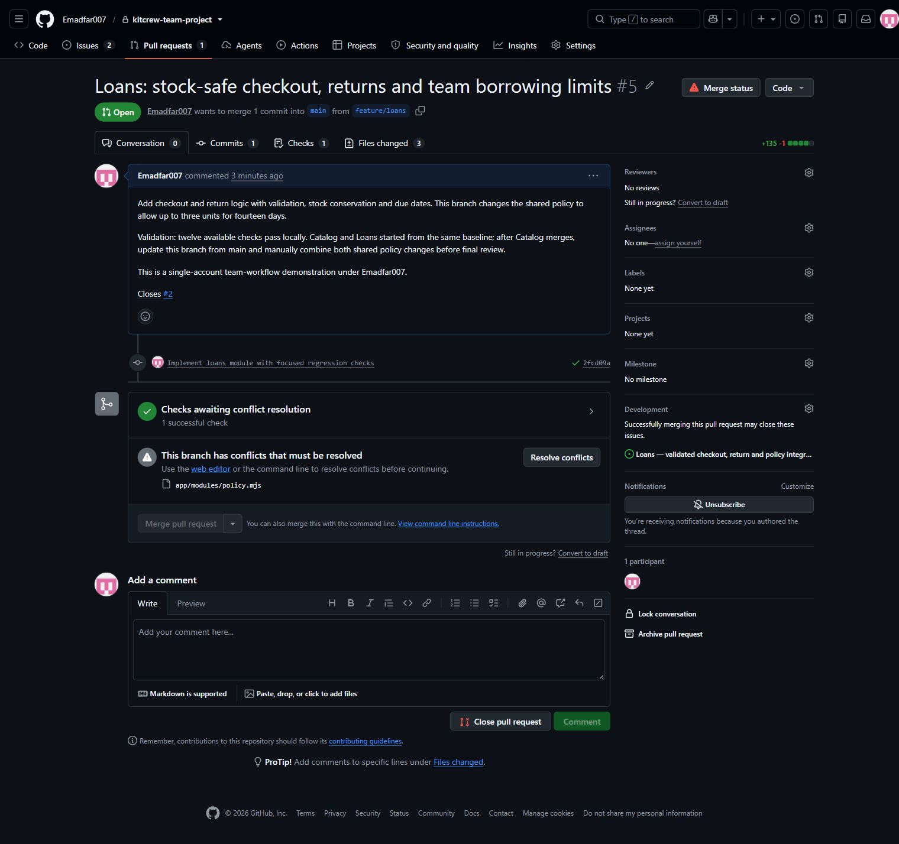
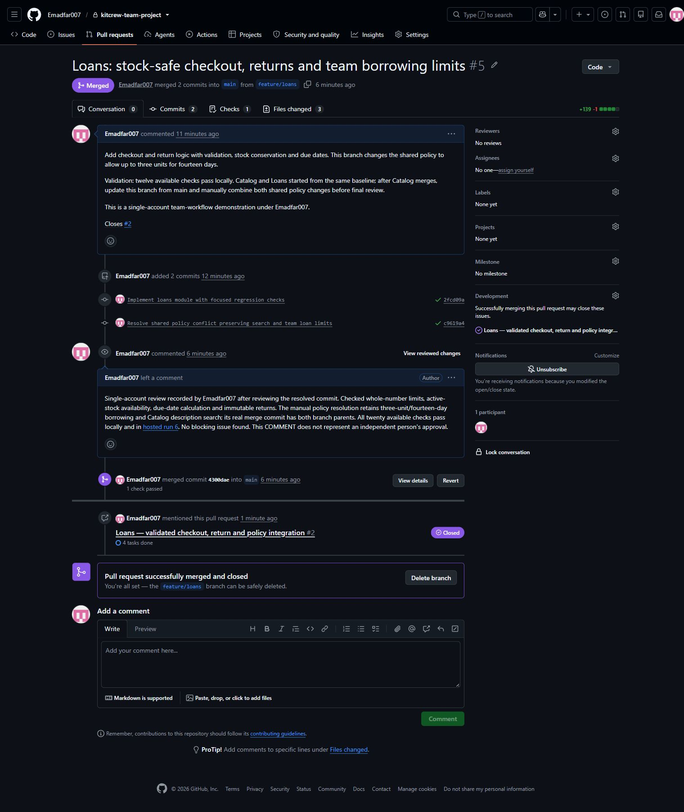
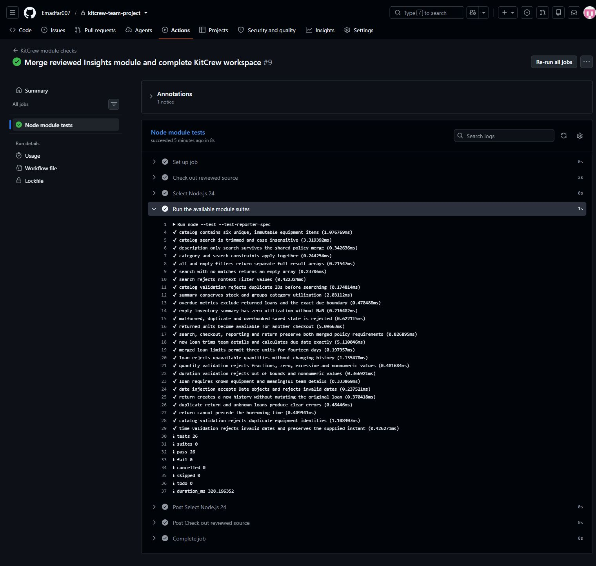
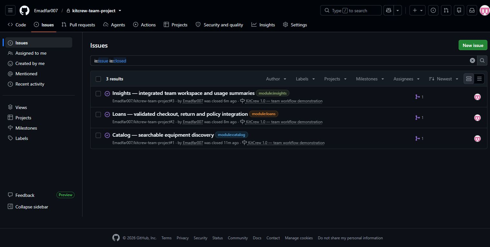

# Experiment 15 — KitCrew: Team Version Control with Git and GitHub

## Aim

To organize **KitCrew**, a shared-equipment workspace for a creative team, in a private GitHub repository; develop individual modules on branches; review and merge pull requests; resolve a genuine merge conflict; and preserve a clear record of the complete workflow.

**Experiment archive:** [CSA1020 Software Engineering](https://github.com/Emadfar007/CSA1020---Software-Engineering/tree/main/experiments/experiment-15-team-version-control) — **Public copy**

**Original workflow repository:** [Emadfar007 / kitcrew-team-project](https://github.com/Emadfar007/kitcrew-team-project) — **Private**

The original branches, issues and pull requests were created in KitCrew. Their links require access to that private repository. This public experiment folder contains the application, ten screenshots and captured Git/GitHub evidence for assessment. Its nested `.github` files preserve the original workflow, templates and ownership configuration; they do not run or configure the parent repository.

## Tools Required

| Tool or feature | Purpose |
|---|---|
| Git | Commits, module branches, fetching, merging and manual conflict resolution |
| GitHub repository | Private source storage and a shared project history |
| Issues, labels and milestone | Requirements, ownership roles, acceptance criteria and delivery tracking |
| Pull requests and reviews | Comments, follow-up commits, resolved discussions and merge records |
| GitHub Actions | Automated Node module tests on application pushes and pull requests |
| Templates, CODEOWNERS and contribution guide | Consistent tasks, module ownership and review instructions |
| Node.js 22 or later | Dependency-free application and tests; CI uses Node.js 24 |
| Browser | Verify the local application and capture actual screenshots |

Only **Emadfar007** was used. Module roles represent a small team's responsibilities; they do not represent additional people or accounts. Reviews are explicitly identified as **COMMENT self-reviews**, supported by code inspection and automated checks. Independent human approval and enforced branch protection are not claimed.

### Quick access links

| What to open | Link |
| --- | --- |
| Open the application | [KitCrew - local workspace](http://127.0.0.1:4845/) · [Local health check](http://127.0.0.1:4845/healthz) |
| Open the public experiment submission | [Report and source archive](https://github.com/Emadfar007/CSA1020---Software-Engineering/tree/main/experiments/experiment-15-team-version-control) · [All ten screenshots](https://github.com/Emadfar007/CSA1020---Software-Engineering/tree/main/experiments/experiment-15-team-version-control/screenshots) |
| Open the original team repository | [KitCrew - private repository](https://github.com/Emadfar007/kitcrew-team-project) |
| Browse the team workflow | [Module branches](https://github.com/Emadfar007/kitcrew-team-project/branches) · [Tracked issues, including completed work](https://github.com/Emadfar007/kitcrew-team-project/issues?q=is%3Aissue) · [Release milestone](https://github.com/Emadfar007/kitcrew-team-project/milestone/1?closed=1) |
| Review the module pull requests | [Catalog and review feedback #4](https://github.com/Emadfar007/kitcrew-team-project/pull/4) · [Loans and conflict resolution #5](https://github.com/Emadfar007/kitcrew-team-project/pull/5) · [Insights and integration #6](https://github.com/Emadfar007/kitcrew-team-project/pull/6) |
| Review the completed documentation | [Workflow evidence pull request #7](https://github.com/Emadfar007/kitcrew-team-project/pull/7) |
| Open automated validation | [Module checks workflow](https://github.com/Emadfar007/kitcrew-team-project/actions/workflows/module-checks.yml) · [Recorded final passing run #9](https://github.com/Emadfar007/kitcrew-team-project/actions/runs/40360742707) |
| Inspect the conflict evidence | [Captured conflict and workflow evidence](https://github.com/Emadfar007/CSA1020---Software-Engineering/tree/main/experiments/experiment-15-team-version-control/evidence) · [Manual resolution record](https://github.com/Emadfar007/CSA1020---Software-Engineering/blob/main/experiments/experiment-15-team-version-control/evidence/conflict-resolution.json) |
| Open the experiment collection | [All experiments](https://github.com/Emadfar007/CSA1020---Software-Engineering) |

The app links are local testing links. To start KitCrew, open a terminal in this experiment directory and run `npm start --prefix app`; no dependency installation is required. The original repository, issues, reviews and checks require a GitHub account with access, such as Emadfar007. The public submission remains accessible separately.

## Algorithm

1. **Create the private team repository.** Create `kitcrew-team-project` under Emadfar007, add the project structure and push `main`. The shared baseline is commit `a0798c67bb45602680f4b2128e8052e87f893157`. Preserve the original private repository and archive the completed experiment here.

2. **Define the work before coding.** Create three module issues with acceptance criteria, role labels, a shared milestone and assignment to the authorized account. Use the issue template to make each task reviewable. The modules are Catalog, Loans and Insights.

3. **Develop separate branches.** Create `feature/catalog`, `feature/loans` and `feature/insights` from the shared baseline. Commit focused changes and push each branch. Preserve the branches after merging for assessment.

4. **Review Catalog through a pull request.** Open [PR #4](https://github.com/Emadfar007/kitcrew-team-project/pull/4). Inspect the diff and submit a formal COMMENT review requesting an explicit regression test for description-search policy. Add the follow-up test commit, reply to the comment, resolve the discussion and re-review the updated head. After its checks pass, merge Catalog into `main`.

5. **Integrate current main into Loans.** On `feature/loans`, fetch the remote and merge `origin/main`. Git reports a conflict in `app/modules/policy.mjs`: Catalog enables description search, while Loans changes borrowing limits. Inspect the working file, `git status --short` and the unmerged index.

6. **Resolve the policy manually.** Preserve both modules' requirements:

   | Setting | Catalog on `main` | Loans branch | Final combined policy |
   |---|---|---|---|
   | Loan duration limit | 7 days | 14 days | **14 days** |
   | Units per loan | 1 | 3 | **3** |
   | Search descriptions | Enabled | Field absent | **Enabled** |

   Edit the file to this valid JavaScript, removing the conflict markers:

   ```javascript
   export const POLICY = Object.freeze({
     maxLoanDays: 14,
     maxUnitsPerLoan: 3,
     searchDescription: true
   });
   ```

   Run the available tests, stage the resolved file and commit the merge:

   ```powershell
   git switch feature/loans
   git fetch origin
   git merge origin/main
   # Edit app/modules/policy.mjs to combine both requirements.
   npm test --prefix app
   git add app/modules/policy.mjs
   git commit -m "Resolve shared policy by preserving catalog search and loan limits"
   git push origin feature/loans
   ```

   The actual resolution is commit `c9619a423d6af2ff44f6248eb730afb6dfc2ce6a`, with two parents. Its record confirms **zero remaining unmerged files** and **20 passing tests** at that integration stage. See the [captured conflict](evidence/policy-conflict.txt), [status and index](evidence/conflict-status.txt), and [resolution receipt](evidence/conflict-resolution.json).

7. **Review and merge Loans.** Update [PR #5](https://github.com/Emadfar007/kitcrew-team-project/pull/5), review the combined behavior and regression coverage, and wait for the hosted Node check. Merge the checked branch into `main`, retaining its conflict-resolution commit.

8. **Complete the connected application.** Integrate Catalog and Loans into `feature/insights`, add aggregation and the browser interface, and open [PR #6](https://github.com/Emadfar007/kitcrew-team-project/pull/6). Review the final diff, run all **26 tests**, and verify the application in the browser. The [hosted validation run](https://github.com/Emadfar007/kitcrew-team-project/actions/runs/40360455504) passed before this PR was merged.

9. **Document and preserve delivery.** Link PRs to their module issues so merges close the tracked work. Preserve the [contribution guide](CONTRIBUTING.md), [ownership file](.github/CODEOWNERS), [PR template](.github/pull_request_template.md), [issue template](.github/ISSUE_TEMPLATE/module-task.md), and [CI workflow](.github/workflows/module-checks.yml). Deliver the report and screenshots through a documentation PR, then tag the checked submission as `v1.0.0`.

10. **Verify the history.** Check merged PRs, closed issues, passing checks, resolved policy and retained branches. Compare local and remote `main` and retain the [command journal](evidence/git-commands.json), [Git history](evidence/git-history.txt), [GitHub workflow evidence](evidence/github-workflow.json), and file checksums in `SHA256SUMS.txt`.

The actual module handoffs are:

| Module | Issue | Feature branch | Pull request | Recorded merge |
|---|---|---|---|---|
| Catalog | [#1](https://github.com/Emadfar007/kitcrew-team-project/issues/1) | `feature/catalog` | [#4](https://github.com/Emadfar007/kitcrew-team-project/pull/4) — review, follow-up and resolved discussion | `1b71bd9138e2d40661490abb2f6d02f2e91ebe94` |
| Loans | [#2](https://github.com/Emadfar007/kitcrew-team-project/issues/2) | `feature/loans` | [#5](https://github.com/Emadfar007/kitcrew-team-project/pull/5) — manual conflict resolution | `4300dae9d5c4acf558a7d8d96dcaa82eebef68ba` |
| Insights and interface | [#3](https://github.com/Emadfar007/kitcrew-team-project/issues/3) | `feature/insights` | [#6](https://github.com/Emadfar007/kitcrew-team-project/pull/6) — full integration | `0d80c08e2439e265962aaeedecfd3fa6f34eb965` |

To run this archived copy, clone the Software Engineering repository and enter the experiment folder:

```powershell
git clone https://github.com/Emadfar007/CSA1020---Software-Engineering.git
cd CSA1020---Software-Engineering/experiments/experiment-15-team-version-control
npm test --prefix app
npm start --prefix app
```

Open [KitCrew locally](http://127.0.0.1:4845/). No dependency installation, database or cloud deployment is required. The app supports equipment search, category filtering, borrowing up to three units for 1–14 days, stock checks, return history, availability insights, browser persistence, JSON export and reset confirmation. Sample records stay in the browser and do not reserve real equipment.

For future changes, update `main`, create a new `feature/<module-name>` branch, make and test a small change, push it, and open a PR. In a real team, another authorized maintainer should review the diff before merging.

## Output Screenshots

**1. KitCrew catalog.** An original equipment-sharing application connects all three modules.


**2. Team loans.** Two sample handoffs record borrower, team, quantity and due date.



**3. Insights.** Five borrowed units out of twenty produce 25% utilization and matching category totals.



**4. Private team repository.** Project source and documentation belong to Emadfar007.



**5. Module branches.** Separate Catalog, Loans and Insights histories remain visible.



**6. Review and follow-up.** The Catalog review leads to a regression test, reply and resolved discussion.



**7. Genuine merge conflict.** Git reports the shared-policy conflict before manual resolution.



**8. Resolved Loans PR.** The final policy preserves borrowing limits and description search.



**9. Passing checks.** Automated tests validate the reviewed application changes.



**10. Tracked delivery.** Linked module issues close after their PRs merge.



## Result

**The private team-project workflow was implemented and demonstrated successfully.** Three individual module branches were reviewed and merged through PRs. The Catalog review produced a real follow-up test commit. The Loans merge produced a genuine conflict, resolved manually with a two-parent merge commit.

The application preserves description search, a 14-day loan limit and a three-unit borrowing limit. All **26 final tests passed**, and **17 browser checks passed** with no failures. Browser verification covered search and category filters, invalid quantities and durations, stock exhaustion, overbooking prevention, saved-state restoration, utilization totals, returns and history, an actual JSON download, reset cancellation and confirmation, and navigation. See the [final test output](evidence/final-tests.txt), [browser verification](evidence/browser-verification.json) and [downloaded workspace](evidence/browser-export.json).

The final [`main` validation run](https://github.com/Emadfar007/kitcrew-team-project/actions/runs/40360742707) also passed after all three modules merged. The repository includes module history, linked issues, review discussions, conflict evidence, contribution instructions, ownership, templates, automated checks and screenshots. The original workflow repository remains private and used only Emadfar007. This public copy joins the other software-engineering experiments; the application runs locally for testing.

**Submission link:** [Experiment 15 in CSA1020 Software Engineering](https://github.com/Emadfar007/CSA1020---Software-Engineering/tree/main/experiments/experiment-15-team-version-control)
